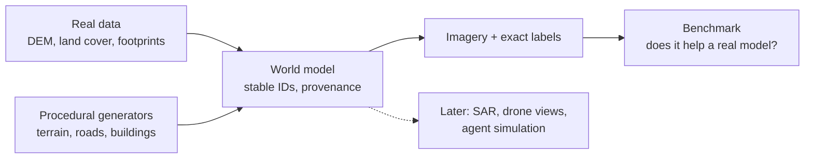

# Fraktal

Procedural world generation for synthetic satellite and geospatial training data. Fraktal builds deterministic, labelled worlds, conditioned on real geography and filled in procedurally, and renders them as satellite imagery with pixel-exact labels.

**Status: early.** The plan is written and the foundations are in place (CLI skeleton, world model, stable IDs). Nothing generates imagery yet. The first milestone is a benchmark that shows whether training on synthetic imagery improves a real building-segmentation model.



## Quick start

Requires [uv](https://docs.astral.sh/uv/) and Git.

```bash
git clone https://github.com/leejianrong/fraktal.git
cd fraktal
uv sync
uv run fraktal version
```

## Usage

Every command can print a machine-readable result with `--json`:

```console
$ uv run fraktal version --json
{"ok": true, "data": {"version": "0.0.1"}, "error": null}
```

The `ingest`, `generate`, `render`, `benchmark` and `inspect` commands exist but exit with code 3 ("not implemented") until their slices land. Exit codes: 0 ok, 2 usage error, 3 not implemented, 4 failure.

## Documentation

- [Plan](docs/PLAN.md): problem, scope, requirements, shape, and later bets
- [Slices](docs/SLICES.md): build order and acceptance tests
- [Decisions](docs/adr/): why it is built this way
- [Open questions](docs/QUESTIONS.md): the decision register

## Contributing

See [CONTRIBUTING.md](CONTRIBUTING.md).

## Licence

Apache-2.0. See [LICENSE](LICENSE).
