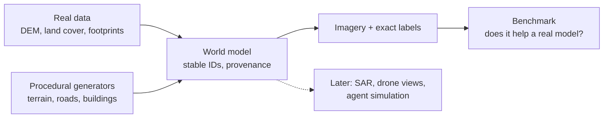

# Fraktal

Procedural world generation for synthetic satellite and geospatial training data. Fraktal builds deterministic, labelled worlds, conditioned on real geography and filled in procedurally, and renders them as satellite imagery with pixel-exact labels.

**Status: active, pre-release.** The plan, CLI, world model, stable IDs, data ingest, the 2.5D renderer and the benchmark harness are in place, and a Blender 3D renderer (the product renderer, ADR-0012) produces drone, satellite and eye-level views with exact labels. Current work makes the generator produce realistic lookalikes of 11 African and Southeast Asian cities, judged against real street photos kept locally for evaluation only. Whether synthetic pretraining helps a real model is still open: see the benchmark notes in [open questions](docs/QUESTIONS.md) (Q14). Taking over on a new machine? Start with [docs/HANDOVER.md](docs/HANDOVER.md).



## Quick start

Requires [uv](https://docs.astral.sh/uv/), Git and Python 3.11 or newer.

```bash
git clone https://github.com/leejianrong/fraktal.git
cd fraktal
uv sync
uv run fraktal version
```

## Usage

Every command can print a machine-readable result with `--json`:

```console
$ uv run fraktal version --json
{"ok": true, "data": {"version": "0.0.1"}, "error": null}
```

The V1 pipeline, in order (data lands under `data/`, which git ignores):

```console
$ uv run fraktal ingest                  # SpaceNet 2 Khartoum (5 GB), DEM and land cover
$ uv run fraktal split --seed 0          # train and held-out test tiles, written as a manifest
$ uv run fraktal generate --seed 0       # skeleton world from train-tile footprints only
$ uv run fraktal synth --regions 3       # render synthetic chips, with sample PNGs
$ uv run fraktal benchmark --synthetic data/synthetic/chips   # IoU for the three arms
```

`render` renders any building layer onto a region. `benchmark` needs PyTorch (`make install-train`) and a GPU for the full recipe. `inspect <world> --id <id>` returns a feature's geometry and provenance as JSON. Exit codes: 0 ok, 2 usage error, 3 not implemented, 4 failure.

## Documentation

- [Handover](docs/HANDOVER.md): setup on a new machine, current state, how a render run works
- [Where data lives](docs/DATA.md): every git-ignored folder, where it came from and how to rebuild it
- [Plan](docs/PLAN.md): problem, scope, requirements, shape, and later bets
- [Slices](docs/SLICES.md): build order and acceptance tests
- [Decisions](docs/adr/): why it is built this way
- [Open questions](docs/QUESTIONS.md): the decision register
- [Research notes](docs/research/): spikes, city profiles, QA and CI

## Contributing

See [CONTRIBUTING.md](CONTRIBUTING.md).

## Licence

Apache-2.0. See [LICENSE](LICENSE).
