# ADR-0010: The 3D path: a headless Blender renderer fed by our world files, with an asset library we own or that is CC0

- Status: Accepted 2026-11-04 (answers Q18)
- Date: 2026-11-04
- Deciders: Jian

## Context

The goal (Q18, PLAN "Later bets" item 0, epic FRK-E6) is whole procedural 3D worlds, a reusable
asset library, and imagery and video from any viewpoint (satellite, aerial, drone, ground) for
dataset building. The current renderer is a 2.5D heightfield with per-class shading and sensor
effects (ADR-0004). Its measured ceiling is visible in ADR-0006: scenes are smooth, textures are
flat, and strong-edge share is the largest remaining gap. Off-nadir views, believable roofs and
real materials need real geometry, materials and light transport.

A research spike (`docs/research/3d-assets-and-realism.md`, FRK-35) compared about 25 options. Its
findings that decide this ADR: licence terms for selling a derived dataset matter more than
render quality; scraped and marketplace assets and several generative-3D model licences are the
weakest on that; Blender with Cycles is free, scriptable and headless; CC0 materials (Poly Haven,
ambientCG) are available; and no source shows that any approach closes the sim-to-real gap for
building segmentation by itself (Synthinel-1 helped only when mixed with real data), which is
consistent with ADR-0009. Many licence points in the note are marked unverified.

## Decision

1. **Renderer: Blender (Cycles) run headless as a subprocess.** It reads our files (GeoParquet
   layers, rasters and an asset manifest) and writes Cloud-Optimized GeoTIFFs plus label rasters,
   or video frames. Stages still talk through files (AGENTS.md), so Blender stays a replaceable
   consumer. Mitsuba 3 stays the fallback; Unreal, Unity and Omniverse are out until their
   licences are confirmed.
2. **The world model is the source of truth, not the renderer.** The stable-ID, per-feature
   provenance, layered files and the procedural generators (terrain, land cover, roads, parcels,
   buildings, biomes) carry over unchanged. The 3D renderer consumes the same layers the 2.5D one
   does and adds geometry and materials from the building and asset specifications.
3. **Keep the 2.5D renderer.** It is cheap, deterministic to the pixel and good for bulk nadir
   data and fast iteration. 3D is the high-fidelity and multi-view path, not a replacement.
4. **Buildings come from our own Python grammar**, not a closed tool: typologies for each biome
   (for Khartoum, courtyard houses, walled compounds, flat-roof blocks), roof types, parapets and
   roof clutter, with every choice drawn from `fraktal.ids.substream`. CityEngine and Houdini are
   avoided (closed, recurring cost, lock-in).
5. **Assets and materials are owned or CC0.** The library has a manifest with a per-row origin,
   licence and an owned or CC0 flag; CI rejects any asset or material without a row, and attribution
   obligations (CC-BY) are not allowed into the default library because they would flow to dataset
   buyers. Poly Haven and ambientCG are the first material sources, after their primary licence
   pages are checked. Objaverse bulk, Sketchfab and marketplace downloads are not used.
6. **Generative assets are an experiment, not a foundation.** Image-to-3D models (TRELLIS.2, SF3D)
   and diffusion texture or style refinement may be tried after the baseline, per model licence,
   with provenance logged and label-preservation checked. Hunyuan3D is excluded by default for its
   territory carve-out.
7. **Determinism is defined as seeded scene equality**: the same seed and config give the same
   scene description (geometry, materials, camera, sun) byte for byte. Pixel equality is not
   promised for path-traced output, since GPU denoising is not bit-exact across drivers.
8. **Measure at each stage, train at milestones.** Stage 0 is a two-day experiment before any
   build: one 1 km tile from existing footprints, extruded, with random CC0 materials, a sky and a
   few instanced props, a nadir camera at about 0.5 m GSD, rendered on one GPU pod. Record seconds
   and cost per tile, and compare side by side with a real Khartoum tile and the 2.5D render using
   the realism gauge and plots. A downstream training run waits for a milestone (AGENTS.md).

## Alternatives considered

- **Unreal or Unity headless:** big asset ecosystems and fast, but EULAs and marketplace terms
  complicate selling derived data, and the toolchain is heavy.
- **Omniverse, Isaac or Replicator:** strong synthetic-data tooling, but the 2026 licence and cloud
  terms are unclear and it needs RT-capable GPUs.
- **Mitsuba 3:** physically exact and pip-installable, but a weaker scene-authoring ecosystem. Kept
  as a fallback and for sensor research.
- **CityEngine, Houdini:** best procedural tools, but closed and costly. Reconsider only if a
  technical artist joins.
- **Scraped or marketplace assets, Objaverse bulk:** fast variety, but per-object licences and
  no-AI disputes could taint a sold dataset.
- **Generative-first (image-to-3D, splats from real imagery):** unproven for top-down fidelity, with
  weaker licence stories and restricted source imagery.
- **Stay 2.5D and improve textures only:** cheaper, and still worth doing for bulk data, but it
  cannot give off-nadir or ground views.

## Consequences

- New work, filed as FRK-E6 stories once this ADR is accepted: the Stage 0 experiment; an asset
  manifest and licence CI check; the renderer file contract and Blender subprocess runner; the
  building grammar (one typology first); a sensor-effects kernel shared with 2.5D; camera
  trajectories (oblique, drone, ground) after nadir is stable; and an Infinigen spike for
  vegetation.
- Add Blender (GPL tool, our scripts private, outputs ours; to be confirmed) to the pod image for
  GPU rendering. RunPod cost per image becomes a tracked number.
- Licence review stays a gate before the first sale (ADR-0007), now including the asset manifest
  and the OSM and Overture question (whether renders from ODbL footprints are produced works is
  unsettled).
- Domain gap is not promised away. Realism work continues in both renderers, and the benchmark keeps
  steering what to build (ADR-0009).

## Open questions

- Output licence statement for Blender and the exact terms of Poly Haven, ambientCG and any add-ons.
- Cost and throughput per image at 1 to 4k pixels, and for video.
- Whether a Blender add-on or geometry nodes is worth it against pure Python mesh building.
- How labels are produced in 3D (object-index passes against rasterised footprints) and how the
  existing label-agreement check ports across.
- Camera and sun trajectories for video, and how they are seeded.

## Stage 0 result (FRK-46, 2026-11-04)

**Verdict: go, with conditions.** Blender Cycles is cheap enough and gives visibly richer
geometry and light than the 2.5D renderer. It does not yet beat it on the gauge, and it should not
be expected to until the sensor and ground work below is shared.

What was built (all in `scripts/blender/` and `src/fraktal/blender_export.py`): the tile is
exported to `scene.json` (building footprints and heights) plus `ground.npy` (ground colours with
roads painted, from the 2.5D palette). `blender_scene.py` builds one ground plane, one extruded mesh for
all buildings, procedural noise materials, a sun and a flat sky fill, and renders nadir with an
orthographic camera in Cycles on CPU, with no tone curve so 8-bit values compare with the 2.5D
render. `stage0_compare.py` renders the same tile in both and scores both against real chips;
`stage0_strip.py` makes the strip. No third-party asset is used, so no licence enters yet.

Same dense_urban tile (the busiest 500 m window, 379 buildings), 0.5 m pixel, 1000 px, run on
this machine with 6 threads, 32 samples, no denoiser:

| | seconds | note |
|---|---|---|
| Blender scene build | 0.4 | pure Python mesh building, no add-on needed |
| Blender render | 26.0 | about 156 thread-seconds |
| 2.5D render | 2.2 | with objects, texture and palette |

Gauge distances (0 is a perfect match). The real sets are tiny and both renders show the same
dense scene, so read the pattern, not the digits:

| against | render | colour | edge energy | noise | contrast | strong edge |
|---|---|---|---|---|---|---|
| Khartoum chips | 2.5D | 0.077 | 0.23 | 0.01 | 0.77 | 0.72 |
| Khartoum chips | Blender | 0.126 | 0.14 | 0.23 | 0.29 | 0.74 |
| Open Cities (Monrovia) | 2.5D | 0.233 | 0.39 | 0.44 | 0.22 | 0.58 |
| Open Cities (Monrovia) | Blender | 0.152 | 0.44 | 0.31 | 0.11 | 0.57 |

Reading it:
- The 2.5D palette is fitted to Khartoum, so it wins colour there. Blender's natural colours win
  against the Monrovia tropical chips. Neither is the better renderer from colour alone.
- Blender has the better edge energy and contrast against Khartoum (real walls, proper shadows)
  and is no better on strong edges or noise, because it has none of the sensor model yet (blur,
  noise, haze) and its ground is a blocky 0.5 m colour image with no texture or trees.
- Every gap Blender shows is something the 2.5D renderer already has. That is the argument for
  FRK-50, the shared sensor-effects kernel: apply the same post-process to both.

Cost. Not measured on a pod: four pod attempts failed (two on my own bugs, two never got past
container start, and one of those held the pod for its whole 50-minute lifetime; about $0.7 spent
in total). From the local thread-seconds, 156 thread-seconds on a 16 vCPU CPU pod at $0.48 an hour
is about 10 s and $0.0013 per 500 m chip. A 1 km tile at 0.5 m is about four times that, $0.005,
and 64 samples doubles it. Treat these as estimates until a pod run lands. Render cost is not the
constraint; scene content is.

Conditions on the go:
1. Share the sensor effects between renderers (FRK-50) before judging Blender on the gauge.
2. Add ground texture and instanced trees, because the flat colour image is the most visible gap.
3. Keep the renderer file contract (FRK-48): the Stage 0 scene files are its starting shape.
4. Take one real pod timing at 1 km before quoting any cost to anyone.

Not tested: Blender GPU, denoising, asset textures, oblique cameras and labels from object
indices. Those stay with FRK-48, FRK-49 and FRK-51.

### After FRK-50: one sensor kernel for both renderers

Haze, tone, contrast, blur and noise now live in `fraktal.kernels.sensor` (arrays in, arrays out,
golden tests). The 2.5D renderer calls `grade` on its float radiance, and its output is
byte-identical to before (checked with every effect on). The Blender path applies `sensor_chain`
and `add_noise` to its finished 8-bit render with the same settings as the 2.5D variant.

Same tile, same Khartoum chips, gauge distances (0 is perfect):

| render | colour | edge energy | noise | contrast | strong edge |
|---|---|---|---|---|---|
| 2.5D | 0.077 | 0.23 | 0.01 | 0.77 | 0.72 |
| Blender | 0.126 | 0.14 | 0.23 | 0.29 | 0.74 |
| Blender + sensor kernel | 0.086 | 0.10 | 0.10 | 0.11 | 0.26 |

The shared sensor closes most of Blender's gaps: against Khartoum it now beats the 2.5D render on
edge energy, contrast and strong edges, and is close on colour and noise. Against the Monrovia
chips it gets worse (colour 0.15 to 0.24, strong edge 0.57 to 0.82), because the sensor settings are
the Khartoum-fitted `v8_objects` variant, whose tone is a green-yellow cast that Monrovia does not
have. That is the sensor config being wrong for the place, not the kernel being wrong; a tropical
profile belongs in the randomised ranges, as for the 2.5D path. Condition 1 of the Stage 0 go is met;
ground texture and trees (condition 2) are next.

### After FRK-56: ground texture and trees

The export now carries the 2.5D renderer's own ground texture (the fractal field, with the same
per-class amplitude, baked into `ground.npy`) and its scattered trees (`scene.json` `trees`: the
same placement code and seed, so the same places). `blender_scene.py` builds the trees as one mesh of
low-poly crown ellipsoids and samples the ground image with linear, not nearest, interpolation.

What the crop shows: the ground is no longer flat colour, the trees are round crowns that cast
shadows, and they sit where the 2.5D trees do. What it still shows: the 10 m land-cover squares
(a property of the world's landcover raster, shared with the 2.5D render) read as patches, and the
trees are small and dark against grass. Cost on a 600 m tile at 1 m, 32 samples, local niced CPU:
about 4.5 s to render with 409 trees and 506 buildings, so trees are not a time problem.

Not claimed: a gauge comparison. I scored a 600 m, 1 m tile against the Khartoum and Open Cities
chips, but those numbers are not comparable with the 500 m, 0.5 m table above, so the table stays
as it was. Rerun at the old settings when the tropical sensor profile lands. Condition 2 of the
Stage 0 go is met in kind (texture and trees exist); remaining conditions are a tropical sensor
profile and one real pod timing at 1 km.

### After FRK-57: sensor settings drawn from the tropical ranges

`stage0_compare.py` takes `--variant v10_tropical --scenes N`: each scene draws haze, tone, contrast,
blur and noise from `randomise.TROPICAL` (FRK-42), and the Blender render goes through the shared
sensor kernel with those settings. Nothing is fitted to the Monrovia chips, which are evaluation
only. The scene's ambient light, bright roofs and cloud are not applied to the Blender path.

500 m tile at 0.5 m, 32 samples, 8 scenes pooled for the tropical rows, gauge distances (0 is
perfect), columns colour / edge energy / noise / contrast / strong edge:

| render | vs Khartoum chips | vs Monrovia chips (5) |
|---|---|---|
| 2.5D, Khartoum-fitted (v8_objects) | .08 .06 .12 .27 .16 | .27 .48 .50 .12 .72 |
| Blender + sensor, Khartoum-fitted | .09 .12 .09 .09 .20 | .25 .45 .49 .37 .80 |
| 2.5D, tropical ranges (v10) | .28 .21 .08 .35 .10 | .09 .40 .39 .07 .78 |
| Blender + sensor, tropical ranges | .14 .32 .10 .00 .29 | .09 .35 .38 .31 .68 |
| Blender, no sensor | .12 .21 .25 .33 .83 | .16 .41 .30 .09 .55 |

Reading it: against Monrovia the tropical ranges fix colour for both renderers (0.25 to 0.09 for
Blender, 0.27 to 0.09 for 2.5D), which is the problem FRK-50 left. The Khartoum-fitted settings stay
better against Khartoum, as they should. The remaining Monrovia gaps (noise 0.38, contrast 0.31,
strong edge 0.68) are not a profile problem: Open Cities is drone imagery averaged down to 0.5 m, so
it is cleaner and crisper than a satellite sensor, and the raw Blender render is closer on noise,
contrast and strong edges. Sensor blur and noise cannot be judged against drone chips; only colour
and scene content can. A real tropical satellite reference would settle the rest, and the Maxar
question (whether CC BY-NC imagery may be used to evaluate) is what blocks it. Five chips from one
scene are also a thin base for any single number. Condition 3 of the Stage 0 go is met for colour;
the pod timing at 1 km is the one open condition.

### After FRK-58: the pod timing

One run on a 16 vCPU CPU pod ($0.48/h, SECURE on-demand, `cpu3c`), commit `1292c90`, driven by
`scripts/runpod/stage0_run.sh`. The boot check passed on the first attempt (the job's first line,
`RP_BOOT`, was in the logs 23 s after launch), so the watchdog was armed but not exercised.

| step | seconds |
|---|---|
| pod launch to first output | 23 |
| install (apt libs, pip, bpy venv) | 33 |
| 1 km tile at 0.5 m (2000 px), 16 samples: Cycles render | 10.0 |
| the same at 64 samples | 37.1 |
| scene build (1150 buildings, 1292 trees) | 0.5 |
| 2.5D render of the same tile | 1.8 to 2.6 |
| whole job to artifact, teardown included | 154 |

A 1 km tile costs about $0.0013 in compute at 16 samples and $0.005 at 64. The earlier estimate
(above) said $0.005 for 16 samples, so it was about four times too high at 16 samples and about
right at 64: it came from thread-seconds on a slower local machine. A 500 px chip (250 m at 0.5 m)
is a sixteenth of the tile, about $0.0003 at 64 samples. The run's own bill was about $0.02 (154 s). Startup and install, 56 s, cost more than one
16-sample tile, so a real batch should render many tiles per pod. Pods left afterwards: 0.

One measurement on one pod type, so it is a figure to plan with, not a benchmark. It also confirms
that the stalls seen earlier were intermittent, not a property of this image or flavor. All three
Stage 0 conditions now have an answer; FRK-48 (the renderer file contract) is next on the 3D path.

### After FRK-48: the renderer file contract

`fraktal render3d WORLD --out DIR --center LON LAT [--size-m --gsd-m --sun-* --seed --samples
--threads --bpy-python --timeout-s]` is the one entry point. The contract is in the
`fraktal.render3d` docstring: a world directory, a tile, a sun and a seed in; `scene/` (the exported
scene), `image.png`, a georeferenced `tile.tif` and `render.json` out. Blender runs as a subprocess
(`fraktal.blender_scene`, under a Python with `bpy`, given by `--bpy-python` or
`$FRAKTAL_BPY_PYTHON`): its progress arrives as `fraktal-log` lines, it is killed at the timeout, and
a failure reports its last 40 lines.

Determinism is seeded scene equality, as decided above: `render.json` carries `scene_sha256`, a hash
of `scene.json` and `ground.npy`, which is identical for the same world, tile, sun and seed and
different for another seed (unit-tested without Blender, using a stand-in script).

On a 16 vCPU pod the CLI rendered a 300 m, 0.5 m tile twice with seed 7: both hashes were
`a05483291707060a`, 52 buildings and 179 trees, Blender 5.0.1, 1.8 s of Cycles at 16 samples. The
pod job is `MODE=render3d scripts/runpod/stage0_run.sh COMMIT OUT`. RunPod had no stock for the first
launch (all three attempts failed in seconds), so the driver now waits 60 s between failed launches.
The real-Blender test is `tests/integration/test_render3d_blender.py`, which runs when
`FRAKTAL_BPY_PYTHON` is set (CI does not have `bpy`).

### After FRK-51: camera trajectories

`fraktal.camera` holds a pose (position in tile metres, heading clockwise from north, off-nadir angle,
field of view, and where the image centre meets the ground) and `trajectory(kind, ...)`, which makes
a seeded `still`, `orbit` (turns through `sweep_deg` around the tile centre) or `flight` (a straight
pass over the centre at a set speed, with a small slow wobble in heading and height). It refuses a
path whose view centre leaves the tile margin. `fraktal render3d --trajectory flight --off-nadir 40
--altitude-m 250 --fov 45 --duration-s 2 --fps 12` renders it: Blender gets a perspective camera
and writes `frames/frame_NNNN.png`, and `render.json` lists every frame's pose. The poses go into
`scene/camera.json`, which is part of `scene_sha256`, so the same seed repeats the same sequence.

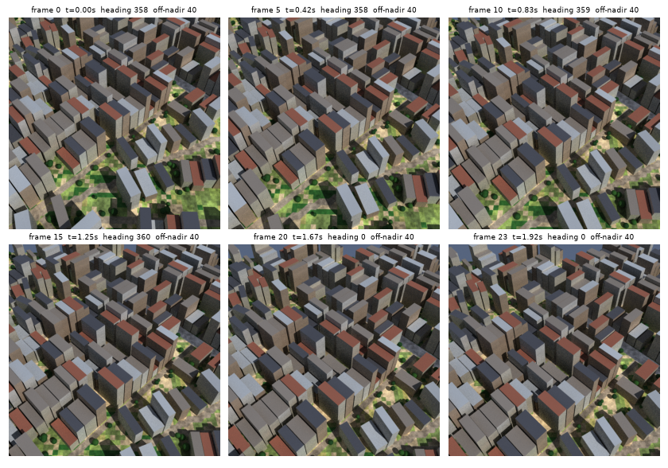

A 24-frame, 640 px flight over a 500 m dense_urban tile took 149 s at 16 samples on 4 local
threads. Limits, as built: the ground is the tile only, so a view that reaches past the tile edge
shows sky; frames are not georeferenced (they are oblique, so there is no `tile.tif`); there is no
motion blur, rolling shutter or lens model beyond field of view; building heights are the
procedural defaults and look tall from the side.

### After FRK-49: one building typology, with materials from the asset library

`fraktal.building_grammar` builds the flat-roof block, one typology, from a footprint, a height and
a roof material: walls, a parapet (an outer lip, inner face and cap stitched edge to edge, skipped
when the footprint is too thin to inset), a flat roof, a window grid per storey (one storey per 3 m,
only on edges of 3 m or more, each bay skipped with a per-building probability), a street door on the
longest edge, and roof clutter (a water tank, a stair box) on roofs of 60 m² or more. Walls pick one
of four finishes, flat roofs one of four (pale, terracotta paint, bitumen, bare concrete), and a
recorded `tin` or `tile` roof uses its own material. Everything is drawn from
`substream(seed, "building:<id>")`, so a building is the same wherever it is built. The mesh goes
into the scene as four `mesh_*.npy` arrays (in `scene_sha256`), so Blender reads data and the grammar
needs no Blender. The old plain extrusion is gone.

Materials come from `assets/`: five ambientCG colour maps (Plaster001, Concrete034, Concrete031,
CorrugatedSteel007A, RoofingTiles013A; CC0-1.0, licence page read 2026-11-05, downscaled to 512 px)
and ten owned JSON material definitions that tint and scale them. Each has a manifest row and the CI
check covers it. Textures are applied by box projection in world metres, so there are no UVs.

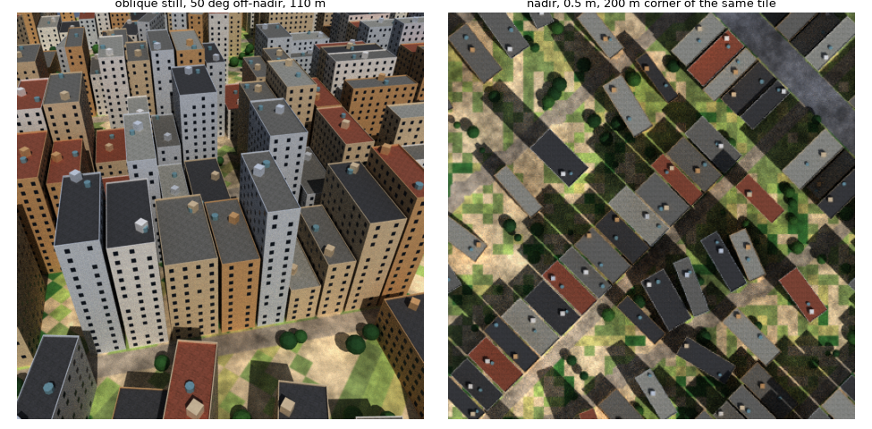

How it looks, said plainly: it reads as a dense mid-rise city, with believable surfaces, window
rhythm, parapets and roof clutter, and the nadir view has the roof-colour variety back. I have no real
oblique chips to put it next to (Open Cities and the Khartoum chips are nadir), so "credible next to
real oblique imagery" is not tested, only judged by eye. Known weaknesses: the towers are far taller
than Khartoum's low-rise (heights come from the world's height model, untouched here); windows are
dark squares with no frames or reveal depth; walls have no balconies, stains or ground-floor
variation; the typology does not fit informal settlement, courtyard houses or tin-roofed sheds, which
still get this block with a tin or tile roof on top. Next typologies and a height model fit would be
separate cards.

### After FRK-61: labels from the 3D renderer

`fraktal render3d` now writes labels next to every render (skip with `--no-labels`): `labels.png` and a
georeferenced `labels.tif` for a nadir tile, `labels/frame_NNNN.png` for a sequence. Red is the class
(0 none, 1 ground, 2 building, 3 tree) and green and blue are a 16-bit instance number, the index into
`render.json["labels"]["buildings"]` (or the tree list) plus one. `fraktal.labels3d.decode` returns the
two arrays. The export gained `mesh_face_building.npy` (which building each mesh face belongs to; it is
in `scene_sha256`).

It is a second Cycles pass over the same scene and camera with an unlit emission material that shows
each face's colour: one sample, a 0.01 px filter, Raw view and **dither off** (Blender's default dither
added plus or minus one to the ids until I turned it off). Workbench would be cheaper but crashes
without a GL context, which a pod does not have. Because it is a render, labels are right for any
camera, occlusion included, and a wall hidden behind another building does not leak.

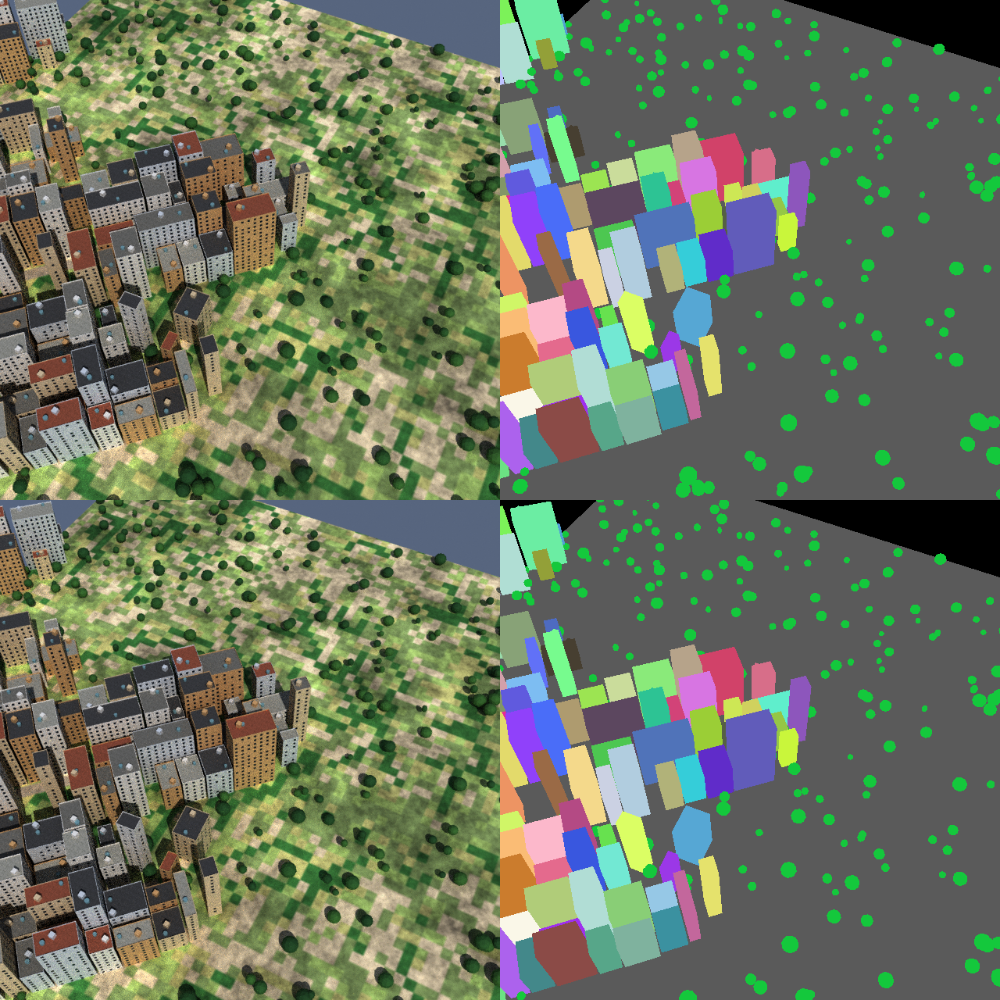

Checked: on a 120 m nadir tile the building labels match the rasterised footprints with IoU 1.0 (the
integration test asks for 0.9), and the label image holds exactly one colour per building, per tree and
for ground. Not covered: a building cut by the tile edge counts as one instance; labels carry no
roads, water or shadow classes yet (roads and water are ground until FRK-69); a label pass adds about
one extra render of the frame at one sample.

### After FRK-62: storey mixes per biome in the 3D path

The towers in the 3D renders came from the world's heights, which were set for the 2.5D shadows and
are taller than Khartoum's low-rise. `fraktal.heights.remap` now gives the 3D path a storey mix per
biome and keeps the world untouched: buildings are ranked by their world height and mapped onto the
distribution, so the tall ones stay the tall ones (they are still near the centres), at 3 m a storey
plus up to 0.8 m of parapet. `khartoum` uses 45/35/12/5/3% of 1 to 5 storeys; `informal_settlement`
and the village biomes use 70/27/3% of 1 to 3; `dense_urban` keeps its world heights. The remap runs
over the whole world, so a building's height does not depend on the tile window, and `--height-profile
world` turns it off.

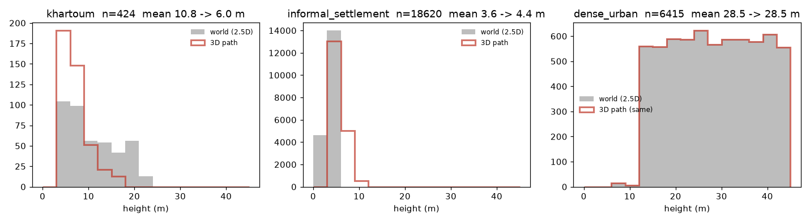

**These mixes are assumptions, not a fit.** The repository has no real height data (SpaceNet and Open
Cities are footprints), so they come from general knowledge of the building stock and should be
replaced if we find a height source. Visible in the plot: Khartoum's mean falls from 10.8 m to 6.0 m;
informal rises a little (3.6 to 4.4 m) because one storey is 3 m and the world's informal heights go
down to 2.5 m; `dense_urban` still has heights to 45 m, which is what a tropical core looks like but
is a choice, not a measurement. The 2.5D renderer, the default world and its pinned hash are unchanged.

### After FRK-63: shed and courtyard typologies

`building_grammar` now has three typologies, chosen per building by `typology_for` and recorded in
`scene.json` (`typology` on each building):

- **shed**: any building with a recorded tin or tile roof. A gable roof along the footprint's long
  axis, split into two planar slopes at the ridge (rise 35% of the half-width, 0.8 to 2.2 m), with
  walls that rise to the ridge at the gable ends. This is what `informal_settlement` buildings get.
- **courtyard**: a rectangle of at least 140 m² and 11 m on its short side, no taller than 7.5 m, drawn
  with probability 0.35 from its own sub-stream (`typology:<id>`). A ring of rooms round an open yard
  (3 to 5.5 m deep), with outer and inner walls, a flat roof ring, and windows facing both ways.
- **block**: everything else, as before. The block's random draws are unchanged, so a block looks the
  same as it did.

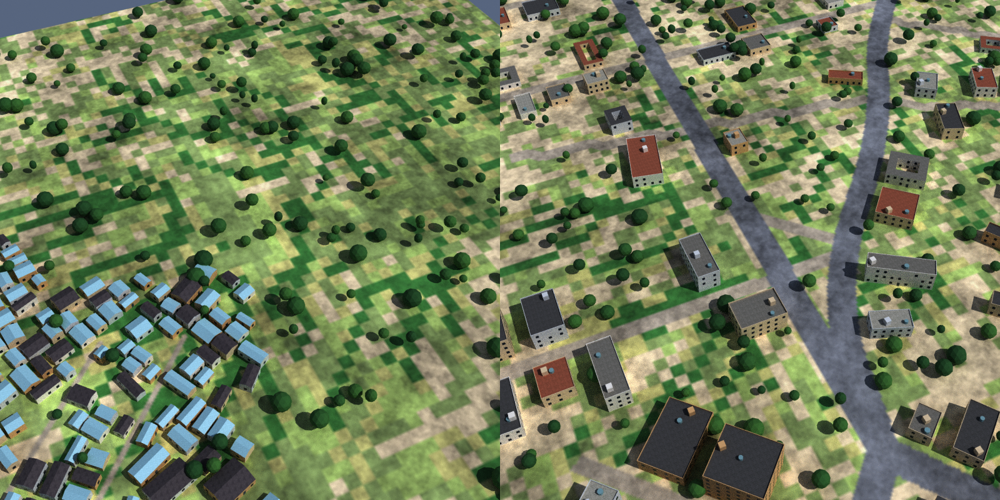

What it looks like: the informal tile now reads as a settlement of pitched tin and tile roofs instead
of towers, and Khartoum (with the FRK-62 storey mix) is low flat-roofed blocks with some yard houses.
Known weaknesses: the tin roof reflects so much sky that it looks pale blue from a high angle; sheds
have no eave overhang or ridge cap and are plain rectangles in plan; a courtyard's yard is ground in
the 3D labels but building in the world's footprint, so on a courtyard house the 3D building label is
smaller than the 2.5D one (the 3D label is the true visible surface); the share of courtyards (35% of
eligible rectangles) is a guess. Not done: L-shaped houses, verandas, multi-wing compounds.

### After FRK-66: tree species

Trees in the scene now carry a species, `broadleaf`, `palm` or `shrub` (a fifth value in each
`scene.json` tree), chosen by `fraktal.trees3d.species_for`: a tree under 3.5 m is a shrub, the rest
are drawn from a per-biome mix with a sub-stream of the tree's own position, so a tree keeps its
species when the tile window changes. Broadleaf is the old round crown, now on a trunk; a palm is a
thin trunk with eight drooping fronds; a shrub is a wide low mound. The tree labels follow the
faces (a tree is no longer a fixed number of faces), and a render of 80 trees shows 80 instances.

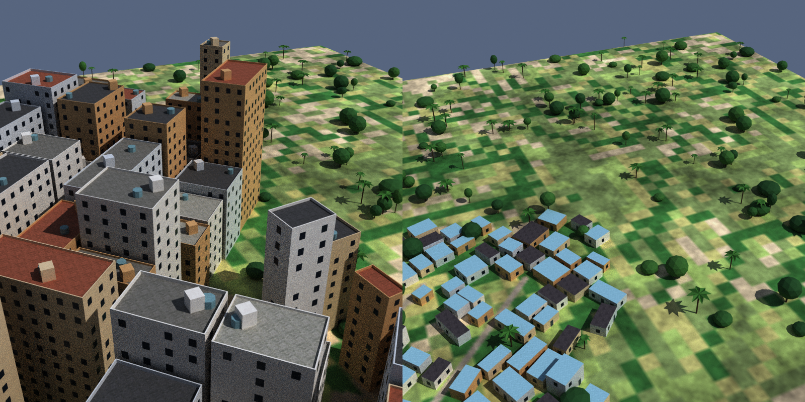

The mixes (khartoum 85% broadleaf, dense_urban 55/35/10 broadleaf, palm, shrub, and so on) are
assumptions, not counts. Palms are narrow and read as small from far away; every broadleaf crown is
the same lumpy sphere, only larger or smaller; trees are still placed by the 2.5D rules (land cover
and density), so **plantation palms in rows are not here**: they need the field geometry, which is
FRK-69.

### After FRK-69: fields, water and plantation palms in the 3D scene

The export now paints the world's field layer into the ground the same way the 2.5D renderer does
(paddy states, bunds, fish ponds, oil-palm ground, terrace bands), below buildings and roads. It also
writes `ground_rough.npy` (in `scene_sha256`): roughness 0.06 for water, flooded paddy and fish ponds,
0.35 for tidal flat, 0.95 elsewhere, which Blender reads as the ground's roughness map so open water
reflects the sky. Every palm of an oil-palm field becomes a `palm` tree, at the field's row
positions (8 to 13 m tall), so the planted rows show.

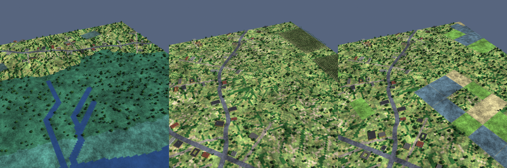

Honest limits: terraces are colour bands on a **flat** ground, because the 3D ground has no relief
(the DEM is not used for height), so there are no terrace steps or risers in the geometry; the glossy
water is dark blue and looks the same as before from this angle (the sheen shows at low angles to the
sun); a plantation is only one field in a corner of this window, and its palms are the same lumpy
fronds as any palm; mangrove trees are the ordinary broadleaf shape. Relief from the DEM is the
obvious next step for the 3D ground, and is not scheduled.

### After FRK-65: vehicles and street props

The 3D scene now has vehicles and poles. `scene.json` carries `vehicles` (x, y, heading, body colour)
and `poles` (x, y, height). Cars are the 2.5D renderer's cars on the painted roads, same seed and
density rules, same heading (the road's direction at that pixel, with a little noise); each is a
4.5 by 1.9 m body with a glass cabin, in one of five body colours. Poles stand every 40 m along any
road at least 6 m wide, alternating sides 1.2 m outside the carriageway, 8 m tall with a lamp head;
footpaths get none. `--vehicle-density` is not a CLI flag yet; `export_scene(vehicle_density=0)` turns
cars off. Labels gained classes `vehicle` (4) and `pole` (5) with their own instances, and
`render.json` lists the counts.

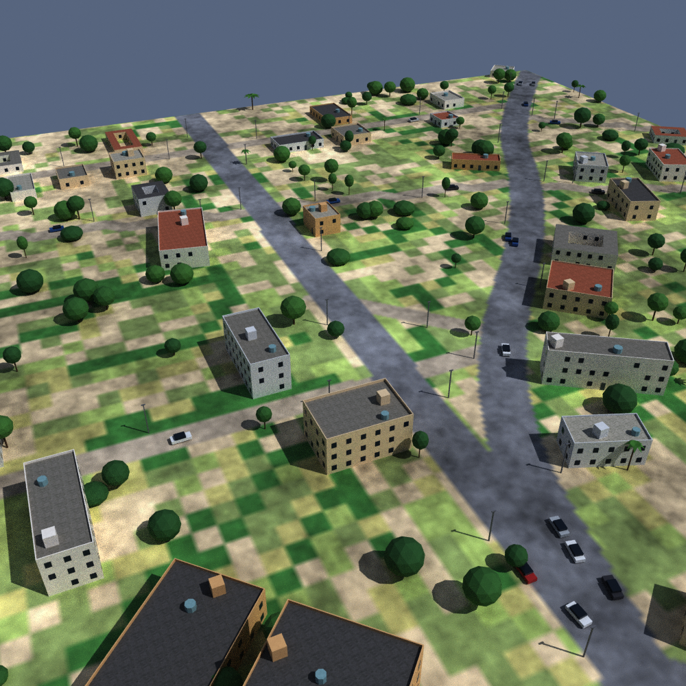

Checked: car headings sit within about 11 degrees of the road's direction at the median (a unit test);
on a 0.5 m nadir tile 29 of 31 cars and 42 of 65 poles show in the labels (the rest are hidden
behind a roof or thinner than a pixel). Limits: cars are boxes (no wheels, no lights), parked cars
and cars in lanes are not distinguished, they cluster on arterials because the 2.5D density is per
hectare of road, and there are no signs, junction furniture, fences or walls.

### After FRK-64: facade detail

Block-typology buildings now have: a darker **plinth** (the lowest 0.9 m of each wall, its own
material, only on walls taller than 2.9 m); **window frames** (a slightly larger light quad just
behind the glass, so each window has a border) and a **sill** under each window; and **balconies** on
35% of buildings of three storeys or more, 30% of their upper-floor bays each (a 1.8 by 0.9 m slab
at floor level with a solid rail on three sides). Three owned material definitions were added
(`window-frame`, `wall-plinth`, `balcony`, with manifest rows; the plinth and balcony reuse the CC0
concrete maps). Balconies and the rest draw from their own sub-stream, `facade:<id>`, so every window
and door stays where it was.

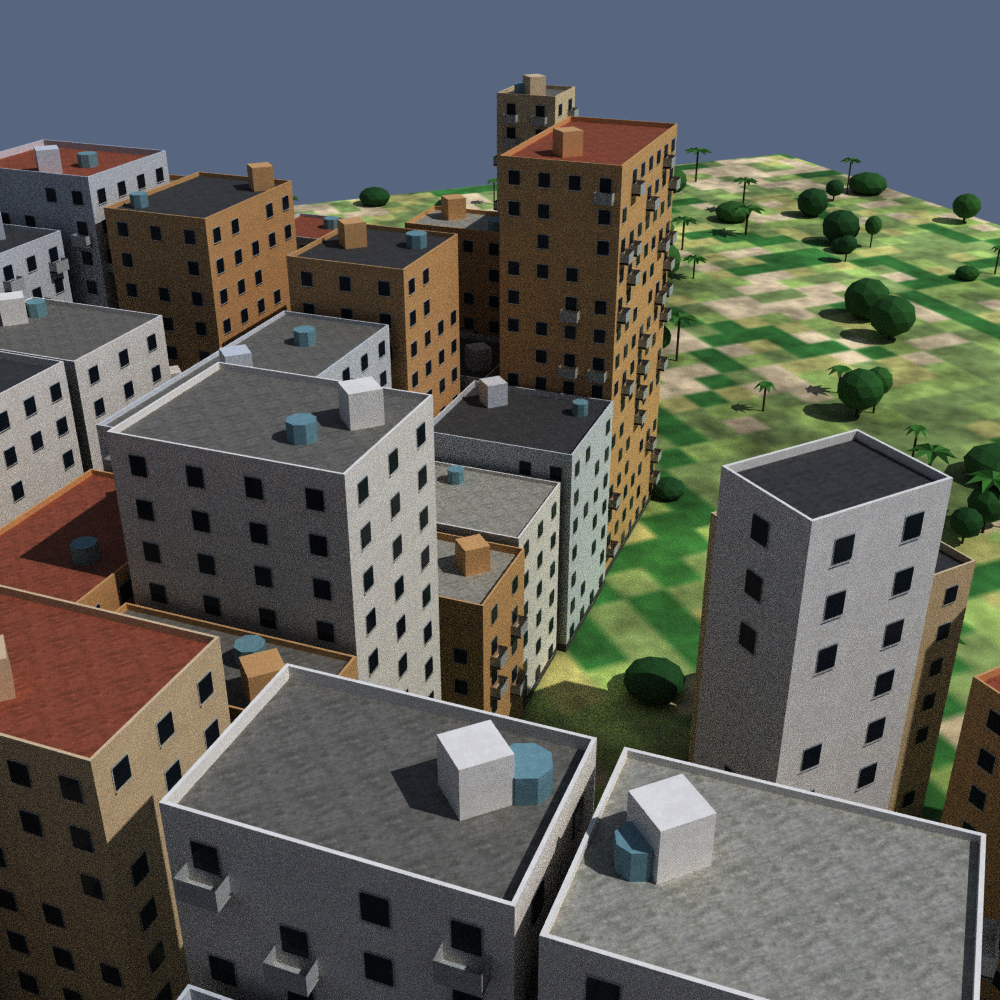

Cost: three faces per window instead of one. On a 300 m dense_urban tile the mesh went from 13.7k to
41.2k faces and the Cycles render from 4.6 s to 5.4 s at 16 samples (one run each, 4 local threads;
not re-measured at 2 km or on a pod). Limits: windows are
still flat quads with a border, not recessed (a wall is one quad with no hole to recess into); there are
no shopfronts, shutters, AC units, stains or lit windows; the plinth is invisible from nadir; sheds
and courtyard houses do not get the detail yet.

### After FRK-67: 3D against 2.5D against ten real scenes

One run of `scripts/blender/stage0_compare.py` per biome: a 1 km tile at 0.5 m, 16 samples, rendered
once in Blender and three times in the 2.5D renderer with the `v10_tropical` randomisation (so three
sensor draws), cut into 500 px chips (16 per render), then scored with the gauge against the 90 chips
of the ten Open Cities scenes from FRK-70. "3D + sensor" is the Blender image through the same sensor
kernel with each draw's settings. Lower is closer to the real chips.

| biome | measure | 2.5D | 3D raw | 3D + sensor |
|---|---|---|---|---|
| dense_urban | colour W1 | 0.086 | 0.194 | **0.074** |
| | edge energy gap | 0.184 | 0.127 | 0.154 |
| | noise gap | 0.141 | 0.465 | 0.141 |
| | contrast gap | **0.039** | 0.108 | 0.201 |
| | strong-edge gap | 0.640 | **0.011** | 0.593 |
| informal_settlement | colour W1 | 0.108 | 0.080 | **0.051** |
| | edge energy gap | 0.129 | 0.346 | **0.012** |
| | noise gap | 0.120 | 0.504 | **0.111** |
| | contrast gap | 0.075 | 0.325 | **0.071** |
| | strong-edge gap | 0.546 | 0.357 | **0.236** |

Read plainly: with the sensor, the 3D path is at least as close as the 2.5D one on 9 of the 10
pairs, and clearly closer for informal settlement (edge energy 0.129 to 0.012, strong edges 0.55 to
0.24). It is worse on dense_urban contrast (0.20 against 0.04) and equal on its noise, and the raw
Blender image is far from real on noise and contrast without the sensor, as expected. Dense_urban's
strong-edge gap is poor for both (about 0.6), so neither reproduces the sharp roof edges of the real
chips there.

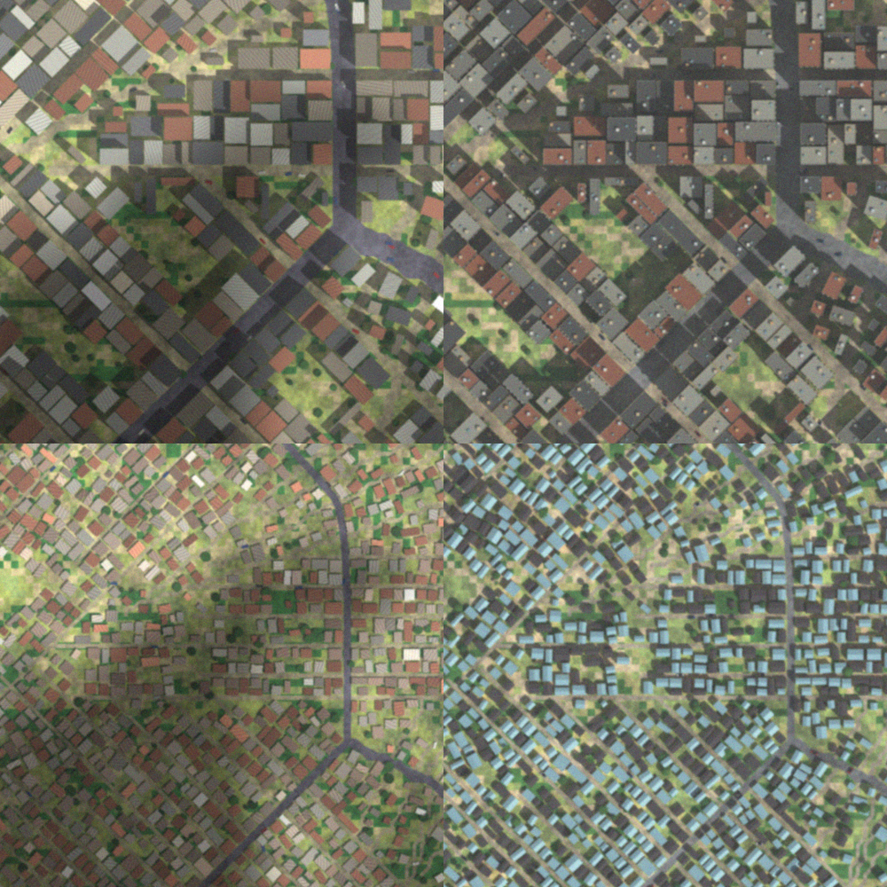

**What this does not show.** One world seed, one tile per biome, three sensor draws, and the same
3D render under all three. Open Cities is 4 to 8 cm drone imagery averaged to 0.5 m, so blur and
noise cannot be judged against it, and 10 of the 60 scenes are in the set. The gauge is
distribution distances, not realism: the strip above shows the 3D informal roofs as **pale blue**
(the tin reflects the sky) where real roofs are red, brown and grey, and the colour distance does not
flag it (it improved). That is filed as FRK-71. The real chips are not in the repository, so the
image shows synthetic output only.

Cost: Blender 24 to 27 s wall for a 2000 px tile against 17 to 22 s for three 2.5D renders (one
laptop, 16 cores), so the 3D path is the same order of cost per tile at 16 samples.

### After FRK-71: roof colours

FRK-67's strip showed informal-settlement roofs as pale blue and near-black, where real roofs are
red, rust, grey and brown. Two causes: the silver tin reflected the blue sky fill, and the CC0 roof-tile
map is dark slate, so about 40% of the roofs (tiles and the shadowed slope) came out black. Changes:

- Tin roofs now come in four colours, drawn per building from its own sub-stream: silver 15%, painted
  red 35%, rust 30%, dark 20% (three new owned material definitions with manifest rows, tinting the
  same CC0 corrugated-steel map; `roof-tin` itself is now rougher so it mirrors less sky).
- The roof-tile tint is raised to terracotta (it multiplies the dark map, so values above 1 are used).
- The shed pitch is lowered from 35% to 22% of the half-width (about 12 degrees), so the slope away
  from the sun is not half as bright as the other.

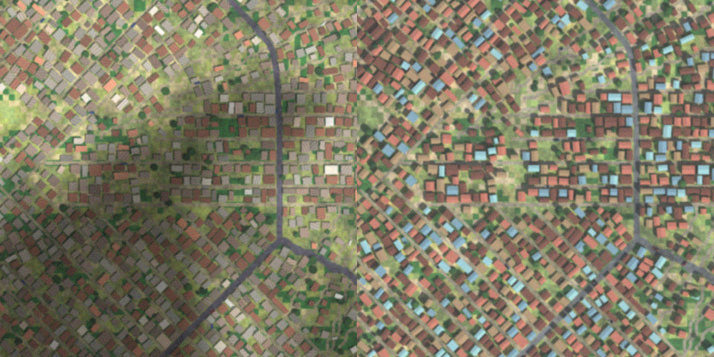

Same run as FRK-67 (informal_settlement, 1 km, three sensor draws, 90 real chips), 3D with the
sensor: colour W1 0.051 to 0.048, edge-energy gap 0.012 to 0.030, noise gap 0.111 to 0.120, contrast
gap 0.071 to **0.167**, strong-edge gap 0.236 to 0.338. So the roofs look right and the gauge got a
little worse on four of five measures, mostly contrast: brighter, more varied roofs raise contrast
beyond the real chips. Per ADR-0009 the strip is the better guide here, but the contrast gap is
a reason to look at the sensor's contrast draw for the 3D path, not a result to hide. About 15% of
roofs are still silver and read cool blue-grey. The numbers are one seed and one tile.

### After FRK-68: batch rendering, 50 tiles on one pod

`fraktal render3d-batch WORLD --out DIR --count N --seed S [--size-m --gsd-m --samples --min-buildings]`
renders many tiles in one process (`fraktal.render3d_batch`). `plan` draws each tile's centre, sun
(azimuth 100 to 260 degrees, elevation 35 to 70, an assumed equatorial sun) and scene seed from
named sub-streams, so the same world, count and seed give the same tiles, and skips windows with no
building. `run` writes `tile_NNNN/` and rewrites `batch.json` after every tile, so a stopped run can
be started again: a tile whose `render.json` has the same `spec_sha256` is skipped, a half-written
one is redone, and a tile that fails is recorded (with its error) while the rest carry on; the exit
code is 4 if any failed. To keep a dataset small each tile keeps `image.png`, `labels.png` and
`render.json` (scene hash, pose, georeference) and drops the scene and the TIFFs unless `--keep-scene`.
`MODE=batch scripts/runpod/stage0_run.sh` runs it on a pod with the same boot check, heartbeat and
teardown as before; per-tile `render3d_batch_tile` lines reach the pod log.

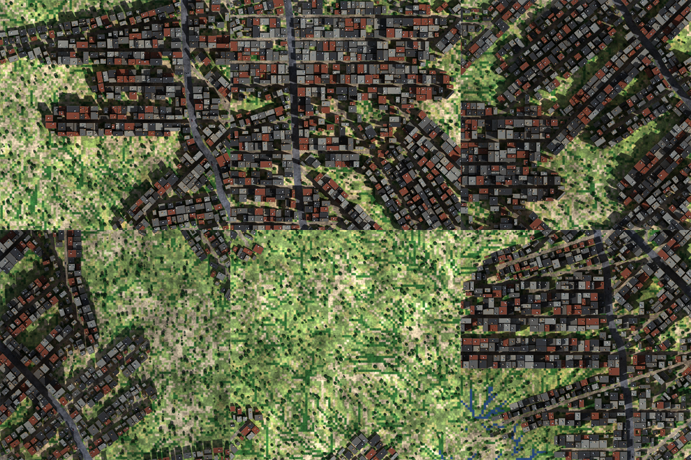

**The run** (pre-merge commit 20d7324, `dense_urban` world of 3 km, 50 tiles of 500 m at 0.5 m, 16 samples, one
16 vCPU CPU pod at $0.48/h): 50 rendered, 0 failed, 50 distinct scene hashes, 717 s in the batch,
14.3 s a tile on average (8.3 to 18.8 s); the whole pod, boot to teardown, was about 15.6 minutes and
the artifact (all 100 images, 105 MB) came back over the relay in about 30 s. From the hourly rate
that is roughly $0.13 for the pod and $0.0025 a tile, about $0.002 for the rendering alone; I did not
read the RunPod bill, so treat the cost as an estimate. The account showed no `fraktal-stage0` pod
afterwards. At this rate 1,000 tiles is about 4 hours and $2.

Limits: every tile is nadir with one sensor-free render (the sensor kernel and tropical draws are
applied afterwards, not in the batch); the world is one biome; the pod ran with the load average
near four times its cores (Blender uses all threads), so the per-tile time may drop with a thread
cap; relaying 105 MB worked, but a 1,000-tile run needs a bucket upload instead; the sun range and
the 40 centre tries are assumptions.

### After FRK-72: sensor pass, six biomes, and the contrast gap

**Contrast gap, looked at and left alone.** FRK-67 and FRK-71 left a question: is the 3D path's
contrast wrong? Measured grey-level spread (std, digital numbers) on the saved FRK-67 tiles: the 90 real
Open Cities chips average 39.0 (10th to 90th percentile 30 to 53). 3D with the sensor draw of scene 0
gives 30 (dense_urban) and 34 (informal_settlement), the low end of the real spread, not outside it.
Across all three draws, before blur and noise, it is 33.5 and 38.5 at the drawn gain and 43 and 50 at
1.3 times it. So the 0.20 gap is one draw on one tile, and the tropical gain range (0.9 to 1.3) already
reaches the real mean. No code change. If a larger sample reads low, widen the 3D gain to about 1.5.

**Sensor in the batch.** `fraktal render3d-batch --sensor` draws each tile's haze, tone, gain, blur and
noise from the tropical ranges (a named sub-stream per tile, so it is in the plan and the resume hash)
and writes `sensor.png` next to the raw `image.png`; `render.json` records the draw. It is the same
`sensor_chain` and noise kernel as the 2.5D path. The cloud cover, bright roofs and ambient draws of the
tropical set are 2.5D parameters and are not applied. `MODE=batch BATCH_BIOME='a b c' SENSOR=1
scripts/runpod/stage0_run.sh` runs several biomes on one pod, a world each.

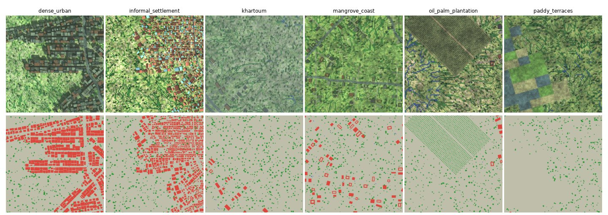

**Smoke run** (commit c892584, one 16 vCPU CPU pod, 3 km worlds, 4 tiles of 500 m per biome, 16 samples):
24 of 24 tiles rendered, none failed. Seconds per tile: dense_urban 7.6, informal_settlement 7.5, and
about 3.1 for the four open biomes. The FRK-68 run on another host took 14.3 s a tile for dense_urban,
so the speed depends on the host; plan with the slower figure. The paddy tile has one building and
mostly flat colour blocks (the 3D ground has no relief), the oil-palm tile shows the plantation rows.

**How big a multi-biome dataset is.** One tile of 500 m at 0.5 m (1000 by 1000 px) is about 2.0 MB for
`sensor.png`, 2.0 MB for the raw `image.png` and 0.04 to 0.12 MB for `labels.png`, measured above. Keeping
the sensor image and labels only is about 2.1 MB a tile; keeping the raw image as well is about 4.2 MB.

| Tiles (six biomes) | Sensor and labels | With raw | One pod at 4.6 s/tile (mixed) | Pod cost at $0.48/h |
|---|---|---|---|---|
| 3,000 (500 each) | 6.3 GB | 12.5 GB | 3.8 h | about $2 (about $5 at 14 s a tile) |
| 12,000 (2,000 each) | 25 GB | 50 GB | 15 h, or 3 pods in 5 h | about $7 (about $22 at 14 s a tile) |

Costs are estimates from the hourly rate. The pod relay worked at 105 MB, not at these sizes, so a real
dataset run needs an object store. Cloudflare R2 fits: no egress fee, 10 GB free, then $0.015 per GB a
month (25 GB is about $0.38 a month), and the S3 API works from a pod. It needs a bucket and a token
scoped to it, which only the account owner can create (FRK-74).

### After FRK-76: generated textures in the library

Four SDXL textures from the FRK-73 trial are in `assets/textures/` under a new licence value,
`generated-permissive`, which `fraktal assets` accepts only with a `generator` block (model, version,
output licence, prompt, seed, date). They are peeling blue paint, cracked plaster, cracked concrete and
clay roof tile, each a seamless 512 px colour map; there is no roughness or normal map for them.
In the grammar, 25% of buildings take one of the three wall textures instead of the CC0 wall, and half
of the tile roofs use the clay tile; both shares are assumptions, drawn from a separate sub-stream so
the existing wall, roof and tin draws of a building do not change.

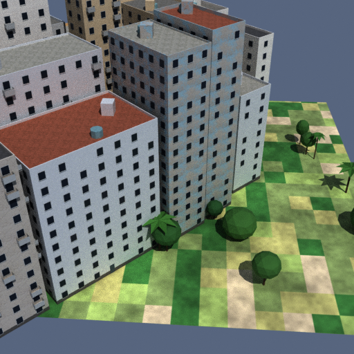

Limits: nadir imagery sees roofs, so the wall textures show up only in oblique views; the paint's blue
reads as a pale blue-grey in this lighting. One render, one seed.
### After FRK-77: ground and tree look

Feedback on the FRK-76 render: the grass was huge pixel squares and the trees were plain balls. Cause:
the 3D ground took the world's 5 m land-cover cells with nearest-neighbour sampling, so every class edge
was a 5 m square (the 2.5D texture only modulates brightness inside a class). Changes, 3D path only
(`blender_export.py`, `blender_scene.py`):

- The class map's edges are bent by two octaves of smooth noise (shifts up to 0.8 and 0.3 cells), then
  the class colours are blurred (sigma 0.3 cell). Roads and field polygons are painted afterwards and
  stay sharp.
- Vegetation gets patches of yellower or bluer green (25 m features, 12%) and a 0.7 m grain (10%) on
  top of the existing 2.5D texture.
- Broadleaf and shrub crowns are finer icospheres with a per-tree radial lump (22%) and six greens
  instead of three.

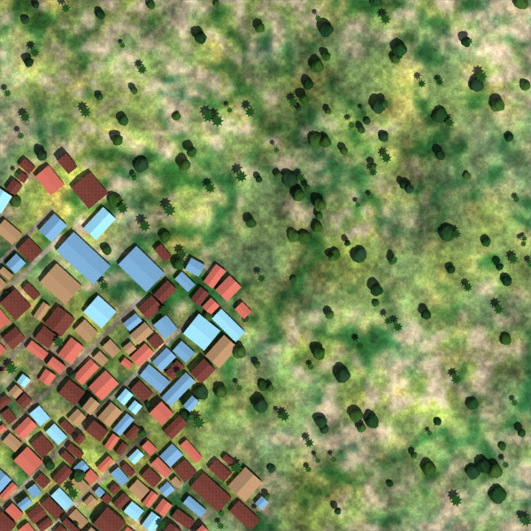
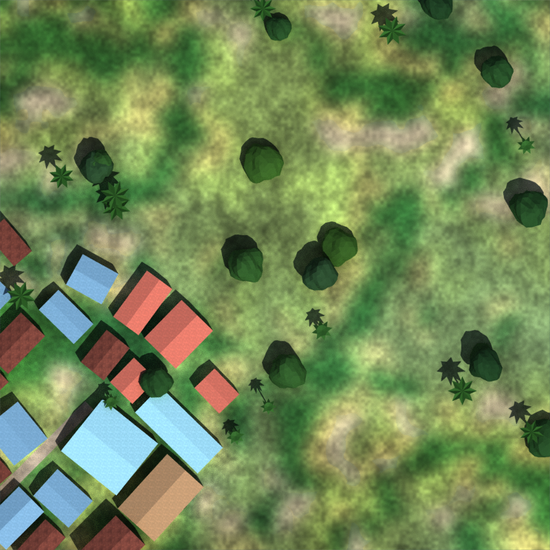

Limits: still a colour image on a flat ground, so no blades or relief; the mottling is noise, not
mapped vegetation, and I did not run the gauge on it (ground colour moved, so the FRK-67 numbers no
longer apply). Trees remain lumpy balls, not branching trees. The world's 5 m land-cover source is
unchanged, so the 2.5D path still shows its squares.
