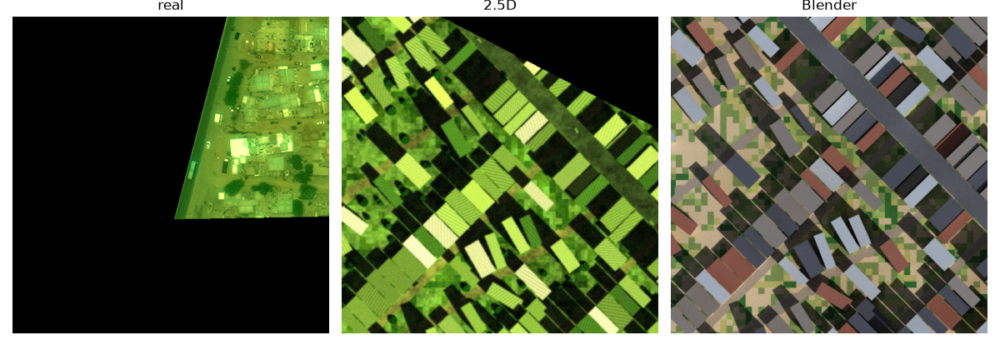
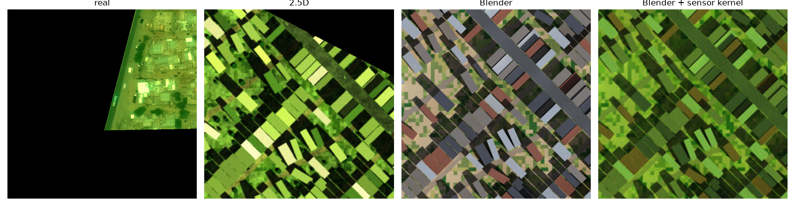
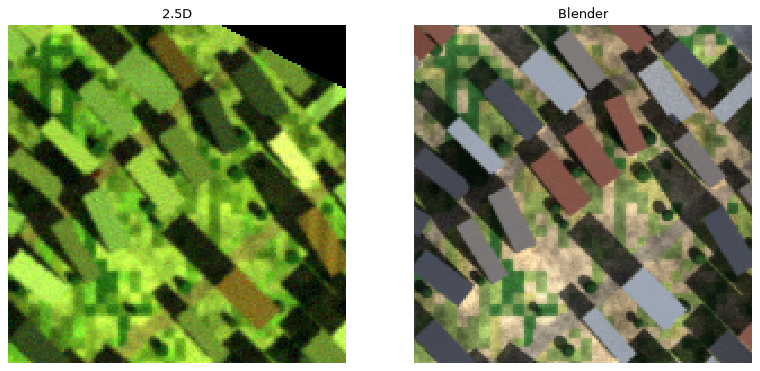

# ADR-0010: The 3D path: a headless Blender renderer fed by our world files, with an asset library we own or that is CC0

- Status: Accepted 2026-11-04 (answers Q18)
- Date: 2026-11-04
- Deciders: Jian

## Context

The goal (Q18, PLAN "Later bets" item 0, epic FRK-E6) is whole procedural 3D worlds, a reusable
asset library, and imagery and video from any viewpoint (satellite, aerial, drone, ground) for
dataset building. The current renderer is a 2.5D heightfield with per-class shading and sensor
effects (ADR-0004). Its measured ceiling is visible in ADR-0006: scenes are smooth, textures are
flat, and strong-edge share is the largest remaining gap. Off-nadir views, believable roofs and
real materials need real geometry, materials and light transport.

A research spike (`docs/research/3d-assets-and-realism.md`, FRK-35) compared about 25 options. Its
findings that decide this ADR: licence terms for selling a derived dataset matter more than
render quality; scraped and marketplace assets and several generative-3D model licences are the
weakest on that; Blender with Cycles is free, scriptable and headless; CC0 materials (Poly Haven,
ambientCG) are available; and no source shows that any approach closes the sim-to-real gap for
building segmentation by itself (Synthinel-1 helped only when mixed with real data), which is
consistent with ADR-0009. Many licence points in the note are marked unverified.

## Decision

1. **Renderer: Blender (Cycles) run headless as a subprocess.** It reads our files (GeoParquet
   layers, rasters and an asset manifest) and writes Cloud-Optimized GeoTIFFs plus label rasters,
   or video frames. Stages still talk through files (AGENTS.md), so Blender stays a replaceable
   consumer. Mitsuba 3 stays the fallback; Unreal, Unity and Omniverse are out until their
   licences are confirmed.
2. **The world model is the source of truth, not the renderer.** The stable-ID, per-feature
   provenance, layered files and the procedural generators (terrain, land cover, roads, parcels,
   buildings, biomes) carry over unchanged. The 3D renderer consumes the same layers the 2.5D one
   does and adds geometry and materials from the building and asset specifications.
3. **Keep the 2.5D renderer.** It is cheap, deterministic to the pixel and good for bulk nadir
   data and fast iteration. 3D is the high-fidelity and multi-view path, not a replacement.
4. **Buildings come from our own Python grammar**, not a closed tool: typologies for each biome
   (for Khartoum, courtyard houses, walled compounds, flat-roof blocks), roof types, parapets and
   roof clutter, with every choice drawn from `fraktal.ids.substream`. CityEngine and Houdini are
   avoided (closed, recurring cost, lock-in).
5. **Assets and materials are owned or CC0.** The library has a manifest with a per-row origin,
   licence and an owned or CC0 flag; CI rejects any asset or material without a row, and attribution
   obligations (CC-BY) are not allowed into the default library because they would flow to dataset
   buyers. Poly Haven and ambientCG are the first material sources, after their primary licence
   pages are checked. Objaverse bulk, Sketchfab and marketplace downloads are not used.
6. **Generative assets are an experiment, not a foundation.** Image-to-3D models (TRELLIS.2, SF3D)
   and diffusion texture or style refinement may be tried after the baseline, per model licence,
   with provenance logged and label-preservation checked. Hunyuan3D is excluded by default for its
   territory carve-out.
7. **Determinism is defined as seeded scene equality**: the same seed and config give the same
   scene description (geometry, materials, camera, sun) byte for byte. Pixel equality is not
   promised for path-traced output, since GPU denoising is not bit-exact across drivers.
8. **Measure at each stage, train at milestones.** Stage 0 is a two-day experiment before any
   build: one 1 km tile from existing footprints, extruded, with random CC0 materials, a sky and a
   few instanced props, a nadir camera at about 0.5 m GSD, rendered on one GPU pod. Record seconds
   and cost per tile, and compare side by side with a real Khartoum tile and the 2.5D render using
   the realism gauge and plots. A downstream training run waits for a milestone (AGENTS.md).

## Alternatives considered

- **Unreal or Unity headless:** big asset ecosystems and fast, but EULAs and marketplace terms
  complicate selling derived data, and the toolchain is heavy.
- **Omniverse, Isaac or Replicator:** strong synthetic-data tooling, but the 2026 licence and cloud
  terms are unclear and it needs RT-capable GPUs.
- **Mitsuba 3:** physically exact and pip-installable, but a weaker scene-authoring ecosystem. Kept
  as a fallback and for sensor research.
- **CityEngine, Houdini:** best procedural tools, but closed and costly. Reconsider only if a
  technical artist joins.
- **Scraped or marketplace assets, Objaverse bulk:** fast variety, but per-object licences and
  no-AI disputes could taint a sold dataset.
- **Generative-first (image-to-3D, splats from real imagery):** unproven for top-down fidelity, with
  weaker licence stories and restricted source imagery.
- **Stay 2.5D and improve textures only:** cheaper, and still worth doing for bulk data, but it
  cannot give off-nadir or ground views.

## Consequences

- New work, filed as FRK-E6 stories once this ADR is accepted: the Stage 0 experiment; an asset
  manifest and licence CI check; the renderer file contract and Blender subprocess runner; the
  building grammar (one typology first); a sensor-effects kernel shared with 2.5D; camera
  trajectories (oblique, drone, ground) after nadir is stable; and an Infinigen spike for
  vegetation.
- Add Blender (GPL tool, our scripts private, outputs ours; to be confirmed) to the pod image for
  GPU rendering. RunPod cost per image becomes a tracked number.
- Licence review stays a gate before the first sale (ADR-0007), now including the asset manifest
  and the OSM and Overture question (whether renders from ODbL footprints are produced works is
  unsettled).
- Domain gap is not promised away. Realism work continues in both renderers, and the benchmark keeps
  steering what to build (ADR-0009).

## Open questions

- Output licence statement for Blender and the exact terms of Poly Haven, ambientCG and any add-ons.
- Cost and throughput per image at 1 to 4k pixels, and for video.
- Whether a Blender add-on or geometry nodes is worth it against pure Python mesh building.
- How labels are produced in 3D (object-index passes against rasterised footprints) and how the
  existing label-agreement check ports across.
- Camera and sun trajectories for video, and how they are seeded.

## Stage 0 result (FRK-46, 2026-11-04)

**Verdict: go, with conditions.** Blender Cycles is cheap enough and gives visibly richer
geometry and light than the 2.5D renderer. It does not yet beat it on the gauge, and it should not
be expected to until the sensor and ground work below is shared.

What was built (all in `scripts/blender/` and `src/fraktal/blender_export.py`): the tile is
exported to `scene.json` (building footprints and heights) plus `ground.npy` (ground colours with
roads painted, from the 2.5D palette). `blender_scene.py` builds one ground plane, one extruded mesh for
all buildings, procedural noise materials, a sun and a flat sky fill, and renders nadir with an
orthographic camera in Cycles on CPU, with no tone curve so 8-bit values compare with the 2.5D
render. `stage0_compare.py` renders the same tile in both and scores both against real chips;
`stage0_strip.py` makes the strip. No third-party asset is used, so no licence enters yet.

Same dense_urban tile (the busiest 500 m window, 379 buildings), 0.5 m pixel, 1000 px, run on
this machine with 6 threads, 32 samples, no denoiser:

| | seconds | note |
|---|---|---|
| Blender scene build | 0.4 | pure Python mesh building, no add-on needed |
| Blender render | 26.0 | about 156 thread-seconds |
| 2.5D render | 2.2 | with objects, texture and palette |

Gauge distances (0 is a perfect match). The real sets are tiny and both renders show the same
dense scene, so read the pattern, not the digits:

| against | render | colour | edge energy | noise | contrast | strong edge |
|---|---|---|---|---|---|---|
| Khartoum chips | 2.5D | 0.077 | 0.23 | 0.01 | 0.77 | 0.72 |
| Khartoum chips | Blender | 0.126 | 0.14 | 0.23 | 0.29 | 0.74 |
| Open Cities (Monrovia) | 2.5D | 0.233 | 0.39 | 0.44 | 0.22 | 0.58 |
| Open Cities (Monrovia) | Blender | 0.152 | 0.44 | 0.31 | 0.11 | 0.57 |

Reading it:
- The 2.5D palette is fitted to Khartoum, so it wins colour there. Blender's natural colours win
  against the Monrovia tropical chips. Neither is the better renderer from colour alone.
- Blender has the better edge energy and contrast against Khartoum (real walls, proper shadows)
  and is no better on strong edges or noise, because it has none of the sensor model yet (blur,
  noise, haze) and its ground is a blocky 0.5 m colour image with no texture or trees.
- Every gap Blender shows is something the 2.5D renderer already has. That is the argument for
  FRK-50, the shared sensor-effects kernel: apply the same post-process to both.

Cost. Not measured on a pod: four pod attempts failed (two on my own bugs, two never got past
container start, and one of those held the pod for its whole 50-minute lifetime; about $0.7 spent
in total). From the local thread-seconds, 156 thread-seconds on a 16 vCPU CPU pod at $0.48 an hour
is about 10 s and $0.0013 per 500 m chip. A 1 km tile at 0.5 m is about four times that, $0.005,
and 64 samples doubles it. Treat these as estimates until a pod run lands. Render cost is not the
constraint; scene content is.

Conditions on the go:
1. Share the sensor effects between renderers (FRK-50) before judging Blender on the gauge.
2. Add ground texture and instanced trees, because the flat colour image is the most visible gap.
3. Keep the renderer file contract (FRK-48): the Stage 0 scene files are its starting shape.
4. Take one real pod timing at 1 km before quoting any cost to anyone.

Not tested: Blender GPU, denoising, asset textures, oblique cameras and labels from object
indices. Those stay with FRK-48, FRK-49 and FRK-51.

### After FRK-50: one sensor kernel for both renderers

Haze, tone, contrast, blur and noise now live in `fraktal.kernels.sensor` (arrays in, arrays out,
golden tests). The 2.5D renderer calls `grade` on its float radiance, and its output is
byte-identical to before (checked with every effect on). The Blender path applies `sensor_chain`
and `add_noise` to its finished 8-bit render with the same settings as the 2.5D variant.

Same tile, same Khartoum chips, gauge distances (0 is perfect):

| render | colour | edge energy | noise | contrast | strong edge |
|---|---|---|---|---|---|
| 2.5D | 0.077 | 0.23 | 0.01 | 0.77 | 0.72 |
| Blender | 0.126 | 0.14 | 0.23 | 0.29 | 0.74 |
| Blender + sensor kernel | 0.086 | 0.10 | 0.10 | 0.11 | 0.26 |

The shared sensor closes most of Blender's gaps: against Khartoum it now beats the 2.5D render on
edge energy, contrast and strong edges, and is close on colour and noise. Against the Monrovia
chips it gets worse (colour 0.15 to 0.24, strong edge 0.57 to 0.82), because the sensor settings are
the Khartoum-fitted `v8_objects` variant, whose tone is a green-yellow cast that Monrovia does not
have. That is the sensor config being wrong for the place, not the kernel being wrong; a tropical
profile belongs in the randomised ranges, as for the 2.5D path. Condition 1 of the Stage 0 go is met;
ground texture and trees (condition 2) are next.

### After FRK-56: ground texture and trees

The export now carries the 2.5D renderer's own ground texture (the fractal field, with the same
per-class amplitude, baked into `ground.npy`) and its scattered trees (`scene.json` `trees`: the
same placement code and seed, so the same places). `blender_scene.py` builds the trees as one mesh of
low-poly crown ellipsoids and samples the ground image with linear, not nearest, interpolation.

What the crop shows: the ground is no longer flat colour, the trees are round crowns that cast
shadows, and they sit where the 2.5D trees do. What it still shows: the 10 m land-cover squares
(a property of the world's landcover raster, shared with the 2.5D render) read as patches, and the
trees are small and dark against grass. Cost on a 600 m tile at 1 m, 32 samples, local niced CPU:
about 4.5 s to render with 409 trees and 506 buildings, so trees are not a time problem.

Not claimed: a gauge comparison. I scored a 600 m, 1 m tile against the Khartoum and Open Cities
chips, but those numbers are not comparable with the 500 m, 0.5 m table above, so the table stays
as it was. Rerun at the old settings when the tropical sensor profile lands. Condition 2 of the
Stage 0 go is met in kind (texture and trees exist); remaining conditions are a tropical sensor
profile and one real pod timing at 1 km.

### After FRK-57: sensor settings drawn from the tropical ranges

`stage0_compare.py` takes `--variant v10_tropical --scenes N`: each scene draws haze, tone, contrast,
blur and noise from `randomise.TROPICAL` (FRK-42), and the Blender render goes through the shared
sensor kernel with those settings. Nothing is fitted to the Monrovia chips, which are evaluation
only. The scene's ambient light, bright roofs and cloud are not applied to the Blender path.

500 m tile at 0.5 m, 32 samples, 8 scenes pooled for the tropical rows, gauge distances (0 is
perfect), columns colour / edge energy / noise / contrast / strong edge:

| render | vs Khartoum chips | vs Monrovia chips (5) |
|---|---|---|
| 2.5D, Khartoum-fitted (v8_objects) | .08 .06 .12 .27 .16 | .27 .48 .50 .12 .72 |
| Blender + sensor, Khartoum-fitted | .09 .12 .09 .09 .20 | .25 .45 .49 .37 .80 |
| 2.5D, tropical ranges (v10) | .28 .21 .08 .35 .10 | .09 .40 .39 .07 .78 |
| Blender + sensor, tropical ranges | .14 .32 .10 .00 .29 | .09 .35 .38 .31 .68 |
| Blender, no sensor | .12 .21 .25 .33 .83 | .16 .41 .30 .09 .55 |

Reading it: against Monrovia the tropical ranges fix colour for both renderers (0.25 to 0.09 for
Blender, 0.27 to 0.09 for 2.5D), which is the problem FRK-50 left. The Khartoum-fitted settings stay
better against Khartoum, as they should. The remaining Monrovia gaps (noise 0.38, contrast 0.31,
strong edge 0.68) are not a profile problem: Open Cities is drone imagery averaged down to 0.5 m, so
it is cleaner and crisper than a satellite sensor, and the raw Blender render is closer on noise,
contrast and strong edges. Sensor blur and noise cannot be judged against drone chips; only colour
and scene content can. A real tropical satellite reference would settle the rest, and the Maxar
question (whether CC BY-NC imagery may be used to evaluate) is what blocks it. Five chips from one
scene are also a thin base for any single number. Condition 3 of the Stage 0 go is met for colour;
the pod timing at 1 km is the one open condition.

### After FRK-58: the pod timing

One run on a 16 vCPU CPU pod ($0.48/h, SECURE on-demand, `cpu3c`), commit `1292c90`, driven by
`scripts/runpod/stage0_run.sh`. The boot check passed on the first attempt (the job's first line,
`RP_BOOT`, was in the logs 23 s after launch), so the watchdog was armed but not exercised.

| step | seconds |
|---|---|
| pod launch to first output | 23 |
| install (apt libs, pip, bpy venv) | 33 |
| 1 km tile at 0.5 m (2000 px), 16 samples: Cycles render | 10.0 |
| the same at 64 samples | 37.1 |
| scene build (1150 buildings, 1292 trees) | 0.5 |
| 2.5D render of the same tile | 1.8 to 2.6 |
| whole job to artifact, teardown included | 154 |

A 1 km tile costs about $0.0013 in compute at 16 samples and $0.005 at 64. The earlier estimate
(above) said $0.005 for 16 samples, so it was about four times too high at 16 samples and about
right at 64: it came from thread-seconds on a slower local machine. A 500 px chip (250 m at 0.5 m)
is a sixteenth of the tile, about $0.0003 at 64 samples. The run's own bill was about $0.02 (154 s). Startup and install, 56 s, cost more than one
16-sample tile, so a real batch should render many tiles per pod. Pods left afterwards: 0.

One measurement on one pod type, so it is a figure to plan with, not a benchmark. It also confirms
that the stalls seen earlier were intermittent, not a property of this image or flavor. All three
Stage 0 conditions now have an answer; FRK-48 (the renderer file contract) is next on the 3D path.
