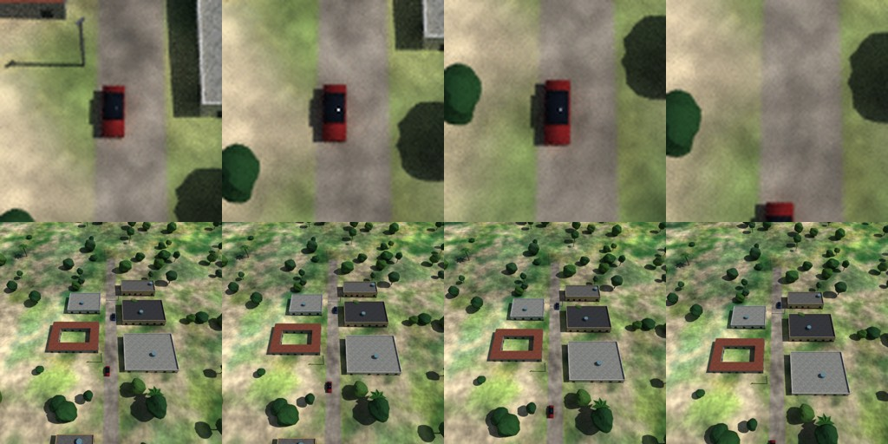
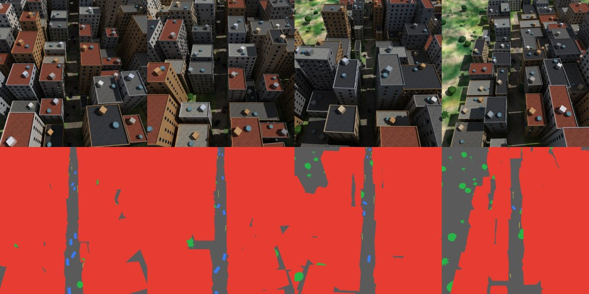
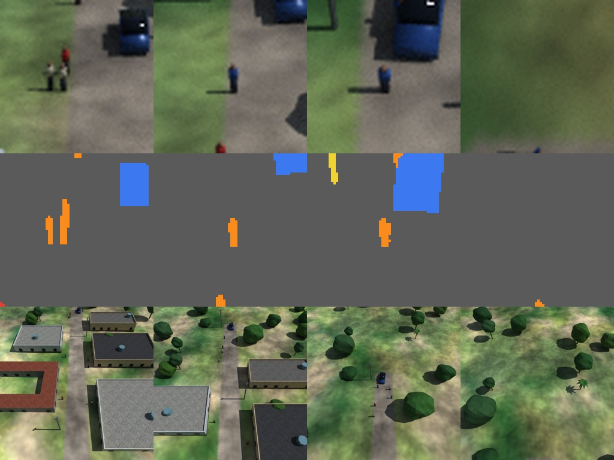
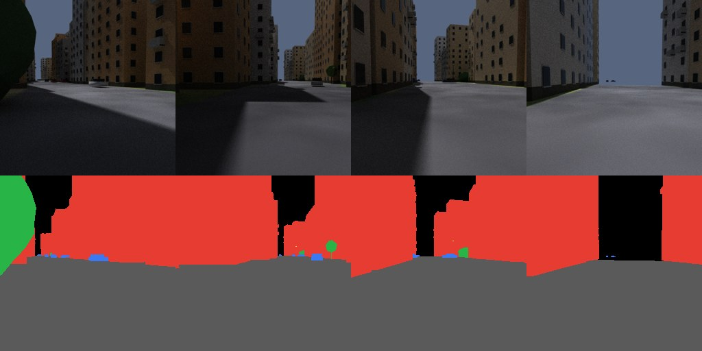
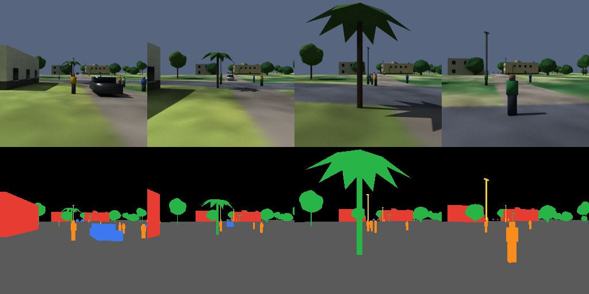

# Plan: moving vehicles and people (FRK-81, ADR-0011 phase 2)

Written 2026-11-05, before any code. Goal: a drone flight or a drive shows cars and people moving
along the world's roads, each with a stable track ID, so labels and tracks line up across frames.

## What exists today

- **Roads:** a `road` layer of LineStrings with `road_class` (arterial 12 m wide, local 6 m), width
  and a bridge flag (`roads.py`). Roads are painted into the ground colour; there is no junction
  graph, no lanes and no traffic rules.
- **Cars:** `blender_export._vehicles` scatters parked boxy cars on road pixels (`objects.place`),
  stored in `scene.json` as `[x, y, heading, colour]`. They never move.
- **Labels:** instance number is the index in a per-class list plus one (`labels3d`); the vehicle
  class is 4. Sixteen bits, so up to 65,534 instances a frame.
- **Frame loop:** `blender_scene.py` poses the camera and renders frame by frame, three passes
  (beauty, labels, depth). Objects are static meshes; nothing is animated.
- **Dynamics:** `kernels/flight.py` (a drone) is the model for how a kernel like this looks.

## Design

**Where the simulation lives.** A new module `fraktal.agents` builds the road graph, picks routes and
returns *tracks*: for every agent, its position, heading and speed at every frame time. It is pure
Python and numpy, deterministic through `fraktal.ids.substream`, and needs no Blender. Tracks are written
to `scene/agents.json` and are part of `scene_sha256`, so a mission is still a seed plus a config
(ADR-0011). The time grid is the camera's frame times, so every pass sees the same world at the same instant.

**Road graph.** Node the road LineStrings where they meet (union, then split at shared points), giving
edges with class, width, length and direction. Two lanes per road, the drive side a parameter
(default left, as in most of the biomes' real counterparts; open question below). A lane is the
centreline offset by a quarter of the road width.

**Cars, first version.** Each car gets a start edge and a route: follow the edge, and at each junction
pick a next edge by seeded choice with no U-turn, until the route is long enough for the whole clip.
Speed per car comes from road class (about 11 m/s on arterials, 6 m/s on local roads) with a seeded
spread, and slows for sharp turns using the same corner rule as the drone kernel. No interaction at
first: cars are spawned with spacing and cannot overtake, but they can pass through each other at
junctions. A second slice adds car-following (the Intelligent Driver Model, a standard rule: speed
follows the gap to the car ahead) and junction yielding. The model is a kernel in
`kernels/traffic.py`: arrays in, arrays out, with a golden test.

**People, later.** Pedestrians walk on the verge of local roads (a strip beside the road edge) at about
1.4 m/s with seeded stops, and cross at junctions. A simple articulated figure built from boxes and
capsules (owned, no licence question) without a walk cycle at first.

**Rendering.** One vehicle mesh with fixed topology (two boxes per car, as now), whose vertex
positions are rewritten for each frame from the track, then lifted onto the terrain with
`lift_to_terrain`. Fixed topology means the label colours painted once stay valid in all passes, and
nothing is rebuilt. Agents outside the tile are parked far underground rather than removed, so
face counts and instance numbers never change. The same update runs in the beauty, label and depth
loops. Parked cars move to the kerb when traffic is on, so moving cars do not drive through them.

**Stable IDs.** Instance number is `parked_count + track_index + 1` for moving cars, so it is the same in
every frame and never collides with a parked car. `tracks.json` maps instance to track and to
agent kind. People get their own class (6) and a block of their own instances.

**Ground-truth tracks.** After rendering, a pass over `labels/frame_NNNN.png` writes `tracks.json`: for every
frame and track, the 2D box of its visible pixels, its pixel count, and the 3D position, heading and
speed from the simulation. That is the MOT-style output a customer expects, and it uses the exact
labels, so occlusion is handled for free.

## Slices

| Card | Slice | Points | Done when |
|---|---|---|---|
| FRK-81 | Road graph and moving-car tracks (no Blender) | 3 | Cars stay on their lane, follow routes through junctions, respect speed limits, are deterministic; a plot of tracks on a road map |
| FRK-85 | Render moving cars in flights, with track IDs and `tracks.json` | 3 | A pod flight shows moving cars, labels follow them, `tracks.json` matches the labels |
| FRK-86 | Car-following and junction yielding | 2 | No overlaps in a busy clip; queues form behind a slow car |
| FRK-87 | Pedestrians on verges and crossings | 3 | People walk beside roads in a flight, labelled as a class of their own |

FRK-82 (ground and dashcam cameras) follows FRK-85: a camera that rides on an agent needs the tracks. Its
rig code can start first, since a camera glued to a moving pose is the same machinery as the drone's.

## Checks

- Unit: tracks stay within half a lane of the centreline; speeds within the class limits; no teleports
  (consecutive positions within speed times time step); same seed, same tracks; different seed,
  different tracks; a car never leaves the graph.
- Kernel golden test for the car model; mypy strict; no Python loops over pixels.
- Pod check each rendering slice: look at the frames, then verify from the files that a car's
  instance number is the same in frame 0 and frame 90 and that `tracks.json` agrees with the label image.

## Risks and unknowns

- **Procedural roads are simple.** Branching and crossings are sparse in the generated worlds, so traffic
  may look thin. Dense urban is the best test; some biomes have little traffic by nature.
- **Bridges.** Roads on bridges would put cars at water level because the ground mesh is the terrain.
  First version skips bridge segments; raising cars to a deck height is a later fix.
- **Quality.** Cars are boxes. Real traffic in these regions is mostly motorbikes and tuk-tuks, which
  matters more for realism than car-following does. A motorbike with a rider is a good follow-up asset
  (built in code, so owned).
- **Pods.** Per-frame mesh rewrites are cheap next to Cycles, but the number of agents times frames
  times three passes is worth timing on a pod before going big.

## Open questions for Jian

1. **Drive side:** left or right? Khartoum is right-hand; most of the tropical SE Asia biomes are left-hand.
   Proposal: a biome setting, left for the SE Asia ones and right for Khartoum.
2. **Which first:** more realistic traffic (car-following, FRK-86) or pedestrians (FRK-87) after the
   first moving cars?
3. **Motorbikes and tuk-tuks:** add them as a vehicle type in this epic, or keep that for a realism pass?

## Status after FRK-81 (2026-11-05)

Answers from Jian: drive side is a biome setting (and can be overridden); car following (FRK-86) comes
before pedestrians (FRK-87); motorbikes and tuk-tuks wait for a realism pass.

Built: `fraktal.agents` (junction graph, two lanes per road on the drive side, seeded routes, per-frame
`Tracks`), `kernels/traffic.py` (speed caps, braking, stepping), `RoadConfig.drive_side` (left for the
five tropical biomes, right for Khartoum; not part of the world id, so existing ids are unchanged),
and `fraktal traffic WORLD --center LON LAT --out DIR`, which writes `agents.json` and a map. On a
2 km tile of the dense_urban world (30.6 km of road, 184 cars, 40 s) the map below shows every car's
path from its start dot: cars follow the roads, turn at junctions and U-turn at dead ends and tile edges.

Known limits, as planned: cars ignore each other, bridges are left out, the generated local roads are
mostly spurs off arterials so the network is sparse, and the tile centre of a world is not always where
the roads are (a 500 m tile at the dense_urban centre held 0.3 km of road). Rendering these tracks is FRK-85.

## Status after FRK-85 (2026-11-05)

`render3d --traffic [--cars-per-km N] [--drive-side left|right]` simulates cars at the frame times of
the camera path, writes them to `scene/agents.json` (part of the scene hash), renders them as a
fixed-topology mesh moved each frame in the beauty, label and depth passes, and writes `tracks.json`
from the exact label images (box, visible pixels and simulated state for every frame a car is visible).
Moving cars have instance `first_instance + k + 1`, with the parked cars first; with traffic on there
are no parked cars yet (they would drive through the traffic), so a car at the kerb is still to do.

Pod checks (16 vCPU, 16 samples, 512 px frames, 8 fps):

| Biome | Frames | Cars | Cars seen | Mismatches | Render time |
|---|---|---|---|---|---|
| dense_urban (left-hand), 25 cars/km | 231 | 95 | 15 (up to 10 in a frame) | 0 | 523 s |
| khartoum (right-hand), 25 cars/km | 102 | 64 | 2 | 0 | not recorded |

"Mismatches" is the count of sampled detections whose pixel count or box differs from a fresh recount in
the label image; zero in both runs. A single car kept the same instance across its whole track (car-0044,
instance 45, frames 0 to 131 in the dense run). Below: crops around one car in four frames of the
khartoum flight, a red car driving down a dirt road, with the full frame underneath.

In the dense town the streets are narrow canyons in deep shadow, so cars show as dark boxes in the beauty
frames while the label image shows them exactly (blue, below). The cars are still boxes, they do not
react to each other (FRK-86). The dense run took about 2.3 s a frame at 512 px for the three passes; the
cost of the per-frame car update was not timed separately.

## Status after FRK-86 (2026-11-06)

Cars now follow and give way (`kernels/traffic.simulate_interacting`, on by default, `TrafficConfig.interact`).
Each step a car follows the nearest car ahead in its lane with the Intelligent Driver Model, and treats a
higher-priority car (arterial before local road, then the lower car number) whose path crosses or merges
with its own within five seconds as an obstacle until it has passed. A car that has stood still for
five seconds stops giving way, so a junction cannot lock up. Oncoming cars are ignored. Cars no longer turn
round at a tile edge: the road goes on, so they drive off the tile.

On a cross of three roads at 40 cars per km, 60 s, same seed:

| | Close pairs (under 2 m, per half-second) | Mean speed | 5th percentile speed |
|---|---|---|---|
| without interaction | 148 | 8.0 m/s | 5.1 m/s |
| with interaction | 25 | 7.0 m/s | 1.2 m/s |

The slow tail is the queues. Overlaps are not gone: the remaining ones are inside the junction, where cars
that turn cut across each other as close as 0.4 m, and cars that have waited five seconds push in. Two
rough edges found on the way, both fixed: two turning cars each saw the other as "ahead" and waited for
ever (the leader rule is now one-way), and cars that U-turned at the tile edge jammed (they now drive off).

## Status after FRK-87 (2026-11-06)

`render3d --traffic --people-per-km N` adds pedestrians. `agents.simulate_people` gives each person a
verge side (1.2 m outside the road edge), a seeded route through the junctions, a pace of 1.4 m/s
plus or minus 20%, and random stops (about two a minute, two to eight seconds each). People are a
label class of their own (`person`, 6), drawn as a three-box figure (trousers, shirt, head) with a
shirt colour per person, moved per frame like the cars, and listed in `tracks.json` after the cars
with `kind: "person"`. A person's instance is their index plus one within the class.

Pod check (khartoum, 80 people per km, 25 cars per km, flying at 45 m along a road at 8 m/s, 161 frames,
512 px, 16 samples, 268 s of render): 204 people and 64 cars simulated, 12 people and 2 cars seen, up to 13
agents visible in a frame, 0 mismatches between `tracks.json` and a recount from the label images. Below:
one walker in four frames (a crop of the render, the same crop of the labels in orange, and the whole
frame); the blue block is a car.

Limits: people and cars ignore each other (people walk across the junction link without waiting, and a
car does not slow for them), there is no walk cycle or crowd behaviour, and the figure is boxes. At the
usual flight height of 90 m a person is only a few pixels, so low flights are the useful ones.

## Status after FRK-82 (2026-11-06)

`render3d --traffic --follow car|person` rides a camera on one agent (`--follow-id car-0007` picks one,
otherwise the one that covers the most ground inside the tile). The camera sits on the agent's track
and looks along its heading: a car camera is 1.25 m up, 0.9 m ahead of the car's centre and pitched 3
degrees down; a person's is at 1.65 m and level (`--mount-height`, `--pitch`, `--fov` change them; the
default field of view is 90 degrees when following). It sits on the terrain, and the agent it rides on
is moved out of sight so the camera is not inside its own car. Poses go to `poses.json` and the video,
labels, depth and `tracks.json` work as for any flight. The tracks are simulated first and the camera
follows them, so the same seed gives the same drive.

Pod checks (16 vCPU, 16 samples, 512 px, 10 fps):

| View | Biome | Frames | Render | Agents seen | Mismatches |
|---|---|---|---|---|---|
| Dashcam on car-0049 | dense_urban | 240 (24 s) | 584 s | 13 cars | 0 |
| Eye level on person-0191 | khartoum | 200 (20 s) | 289 s | 17 people and 7 cars, up to 19 in a frame | 0 |

Limits: the ground mesh ends at the tile edge, so a long view shows the edge against a flat sky; the
dense town is in deep shadow at street level; the walker and the car move at their simulated pace, so
a pedestrian video changes slowly; and only one camera rides per render.
