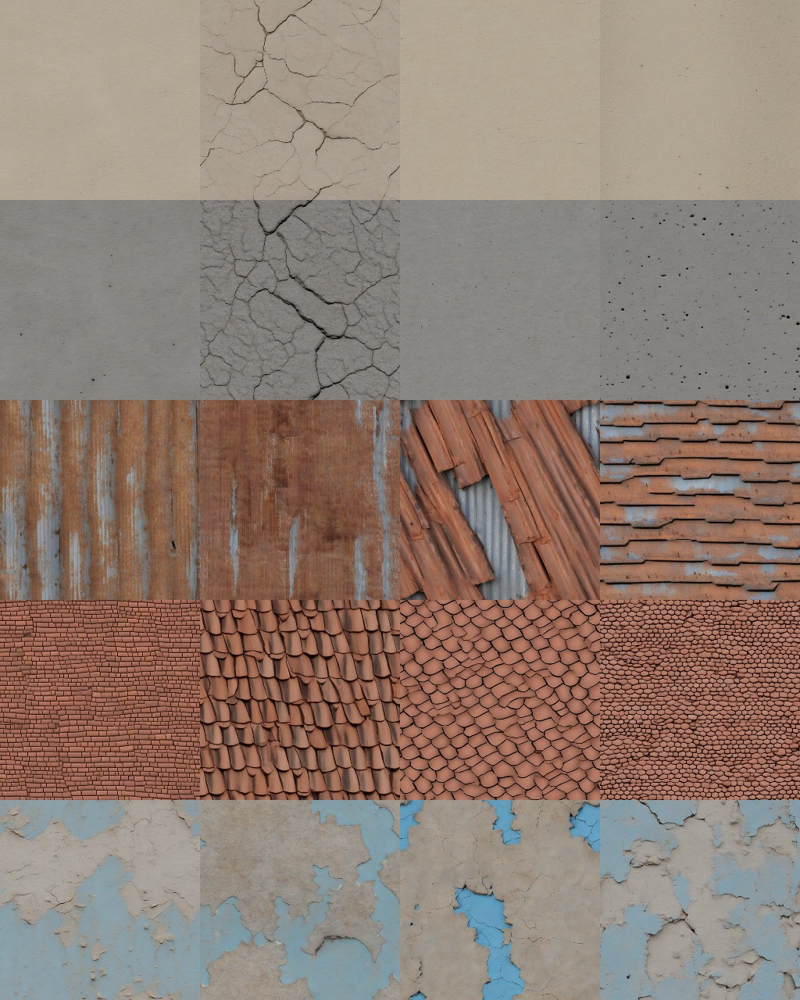

# Spike: image-model textures for the asset library (FRK-59)

Status: licence and policy work done from primary texts on 2026-11-05. **The generation trial was run the
same day with SDXL** (FRK-73, see "The trial" below). Verdict: worth using for some roles, not all.

## Which models may we use, and for what

Read from the licence files themselves, not from blog summaries:

| Model | Licence | Outputs | Verdict for us |
|---|---|---|---|
| FLUX.1 schnell | Apache-2.0 (BFL model card on GitHub, `model_cards/FLUX.1-schnell.md`) | no extra terms found | Usable, including for sold datasets. Weights on Hugging Face are gated, so a pod needs an HF token (a credential we do not hold). |
| SDXL base 1.0 | CreativeML Open RAIL++-M, 2023-07-26 (`LICENSE.md` on Hugging Face) | "Licensor claims no rights in the Output"; use restrictions apply (no illegal or deceptive use) | Usable, ungated download. Use-based restrictions must be passed on if we redistribute the *model*, not the images. |
| FLUX.1 dev | FLUX.1 [dev] Non-Commercial License | Outputs may be used commercially (section 2(d)), but the model itself may not be used for revenue-generating activity, and outputs may not train a model competitive with FLUX | **Out.** Generating textures for a product we sell is revenue-generating use of the model. |
| SD3 | Stability community licence | not read | Not assessed; no need, the two above cover it. |

## Can a generated texture be "owned" in the manifest

Two separate questions:

1. **Licence permission.** SDXL and schnell both disclaim any claim on outputs, so we may ship them.
2. **Copyright.** The US Copyright Office's January 2025 report says prompts alone do not make the user
   the author, so a purely generated image is probably not copyrightable. That is a secondary-source
   reading; I did not read the report. Consequence: we cannot claim to *own* these in the copyright sense,
   but nobody else can claim them either, so they are safe to use and to ship. We also cannot stop a
   buyer copying them. Textures are not what the dataset is sold for, so that is acceptable.

Proposed manifest rule (not implemented, the checker is unchanged): a new licence value
`generated-permissive`, accepted only with a `generator` block (model, version, licence, prompt, seed,
sampler settings, date). The README rule becomes "owned, CC0, or generated by a model whose output terms
we have read". That keeps ADR-0010 decision 5 honest: every row still has a verified source.

## Why the trial was not run first

- schnell's weights need a Hugging Face token. I do not have one and will not ask for it in chat.
- SDXL needs `diffusers` and about 7 GB of weights on a GPU pod. That is cheap (a few cents), but it is
  installing third-party code on a paid pod, and my last request to install third-party code was refused
  by the permission check, so I'd rather you decide.
- So tileability, consistency with real Khartoum walls and roofs, and cost per texture are **untested**.

## Trial plan (about 30 minutes, under $0.50)

1. A 24 GB GPU pod through `scripts/runpod`, same boot-check and teardown as the Blender runs.
2. SDXL base, 20 steps, circular-padding trick (set Conv2d `padding_mode='circular'`) for seamless tiles,
   1024 px, then downscale to 512 to match the CC0 set.
3. Five roles: plaster wall, rough concrete, corrugated tin, clay roof tile, weathered paint. Four seeds each.
4. Judge tileability by tiling 3x3 and looking at the seams, and appearance by rendering one tile with
   each, next to the CC0 versions. Record seconds and dollars per texture.
5. Reject anything with text, logos or recognisable objects.

## Recommendation

Do the trial with SDXL (ungated) if you approve the install. Treat the result as a way to widen the
distribution (more wall and roof variety), per ADR-0009, not as a replacement for the CC0 set. Do not add
the `generated-permissive` licence value until the trial shows a texture worth keeping.

## The trial (FRK-73, 2026-11-05)

Method chosen: SDXL base through `diffusers` (pinned 0.35.1, transformers 4.56.1, accelerate 1.10.1), not
the Hugging Face token. SDXL is ungated, so there is no credential to hand over, and FLUX schnell would
only add a token and a gated download for a texture job where SDXL is already good enough. The install
ran inside the pod's own container in a venv, and the pod was terminated afterwards.

Setup: one RunPod A40 (secure cloud, $0.59/h), SDXL base fp16, 20 steps, 1024 px (shown at 512), Conv2d
padding set to circular in the UNet and VAE so the output wraps, five roles by four seeds
(`scripts/textures/sdxl_trial.py`, driven by `scripts/runpod/textures_run.sh`).

| Measure | Result |
|---|---|
| Model load | 12.6 s (a warm cache on that host; a cold pull is longer) |
| Per texture | 4.7 s at 1024 px; the whole run, 20 images, 107 s |
| Cost | about $0.002 a texture; the pod, boot to teardown, was about 3 minutes, so roughly $0.03 to $0.05 (estimated from the rate, not the bill) |
| Seam score (wrap step over typical step; 1.0 is invisible) | 0.56 to 1.18, median about 0.97; the paint tiled 3x3 shows no seam |

What the images show:

- **Weathered paint and clay roof tile are good**: varied, believable, and different from the CC0 set.
- **Plaster and concrete are mostly near-flat**; two of eight show large cracks. Useful as plain walls
  and as a crack variant, thin as texture detail.
- **Corrugated tin is poor**: seed 0 is a rusted vertical strip pattern, the others are not corrugated
  at all (one is shingles). Keep the CC0 tin.
- **Repetition is visible** when tiled (the 3x3 paint shows the same band every 512 px). Fine for walls
  seen small at 0.5 m per pixel, not for a close-up.
- No text, logos or objects appeared in these 20.
- One prompt and one seed set. I did not try other prompts, a different model or a roughness map, and
  a generated image has no normal or roughness data, only colour.

Verdict: use it to widen the wall and roof palette (paint, clay tile, cracked plaster), per ADR-0009. It
does not replace the CC0 set and does not help tin. Nothing is added to `assets/` yet: that needs the
`generated-permissive` manifest rule above (model, version, prompt, seed, date per row) and a renderer
change to take extra wall and roof maps. Filed as a follow-up.
